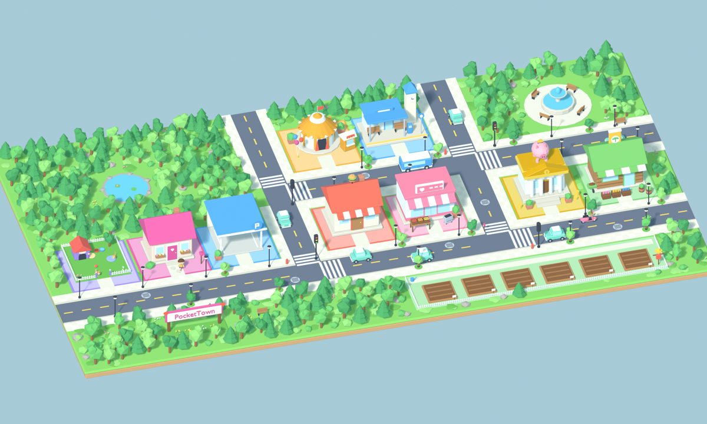
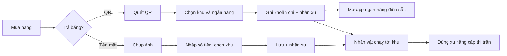

# PocketTown 🏘️

**Ứng dụng ghi chép chi tiêu biến mỗi khoản chi thành một bước xây thị trấn 3D.**

Mỗi lần ghi một khoản chi, nhân vật của bạn chạy tới khu tương ứng trong thị trấn (Ăn uống, Mua sắm, Giải trí...) và bạn nhận **xu**. Xu dùng để nâng cấp nhà, mua xe, trồng cây. Ghi chép đều thì thị trấn lớn dần.

| | |
|---|---|
| 📄 Tài liệu yêu cầu nghiệp vụ | [BRD](docs/BRD.md) |
| 📐 Đặc tả yêu cầu phần mềm | [SRS](docs/SRS.md) |
| 🎨 Thiết kế UI/UX + prototype | [Figma: 51 màn hình, bấm thử được mọi nút](https://www.figma.com/design/DzLoLblVhyGTE3Xntfhcvo) |
| 📱 Nền tảng | iOS (Expo / React Native), đã chạy trên iPhone thật |

---

## Vấn đề

Người trẻ Việt Nam chi tiêu chủ yếu bằng **quét VietQR** và **tiền mặt**, nhưng app ghi chép hiện có thì khô khan, bắt nhập lại số tiền, và hay đòi đăng nhập. Người dùng bỏ sau 1–2 tuần.

## Giải pháp

| Vấn đề | PocketTown giải quyết bằng |
|---|---|
| Ghi chép nhàm chán | Game hoá: nhân vật, thú cưng, xu, nâng cấp 7 cấp, xe, vườn cây |
| Nhập lại số tiền khi trả QR | **Quét VietQR → chọn ngân hàng → app tự ghi và mở app ngân hàng với thông tin điền sẵn** |
| Quên khoản tiền mặt | Chụp ảnh món vừa mua, nhập số tiền ngay trên ảnh |
| Ngại lộ dữ liệu | Không tài khoản, không máy chủ; dữ liệu và ảnh chỉ nằm trên điện thoại; sao lưu bằng file |
| Báo cáo khó đọc | Báo cáo tháng với dự kiến cả tháng, phân bổ theo khu, **lịch Đầu tư** dạng nhiệt |

## Tính năng chính

- **Thị trấn 3D tương tác**: chạm công trình để nhân vật chạy tới, xem chi tiêu và nâng cấp.
- **Quét QR chuyển khoản**: đọc chuẩn VietQR, hỗ trợ 18 ngân hàng; ngân hàng không nhận thông tin từ app khác thì PocketTown tạo mã QR có sẵn số tiền để mang sang.
- **Chụp ảnh ghi chi tiêu** kiểu Locket.
- **Khu chi tiêu tự tạo**: chọn tên, màu, kiểu nhà; được xây trên lô đất trống.
- **Xu và nâng cấp**: luật thưởng chống lạm dụng (tối đa 50 xu/khoản, thưởng ảnh tối đa 50 xu/ngày), xoá khoản thì trừ lại xu.
- **Báo cáo tháng** và **tiền nhận vào** đọc từ tin nhắn ngân hàng (không tính là chi tiêu).
- **Sao lưu / khôi phục** bằng file JSON, có hoàn tác.

## Luồng chính

## Công nghệ

| Phần | Công nghệ |
|---|---|
| Ứng dụng | Expo SDK 58, React Native, TypeScript (strict) |
| 3D | Three.js trên expo-gl, mô hình GLB |
| Mô hình 3D | Blender 5.2, dựng bằng script Python |
| Dữ liệu | SQLite trên máy (expo-sqlite), migration đánh số |
| Kiểm thử | Jest cho logic nghiệp vụ (xu, VietQR, tin nhắn ngân hàng, sao lưu) |
| Thiết kế | Figma (biến màu, thành phần, prototype đầy đủ luồng) |

## Nội dung tài liệu

**[BRD](docs/BRD.md)**: bối cảnh và vấn đề, mục tiêu kinh doanh kèm KPI, các bên liên quan, persona, phạm vi, sơ đồ quy trình hiện tại và quy trình mới, 14 yêu cầu nghiệp vụ (MoSCoW), 12 quy tắc nghiệp vụ, rủi ro, tiêu chí thành công, lộ trình, nhật ký quyết định.

**[SRS](docs/SRS.md)**: 55 yêu cầu chức năng gắn với màn hình Figma, đặc tả ca sử dụng (luồng chính, thay thế, ngoại lệ), sơ đồ ca sử dụng, sơ đồ tuần tự, sơ đồ trạng thái, mô hình dữ liệu (ERD), 15 yêu cầu phi chức năng có cách đo, ma trận truy vết BRD → SRS → Figma, tiêu chí nghiệm thu dạng Given/When/Then.

## Lộ trình

- [x] Thị trấn 3D chạy 60 fps trên iPhone
- [x] Ghi chi tiêu bằng QR và ảnh
- [x] Xu, nâng cấp, xe, vườn cây
- [x] Báo cáo, tiền nhận vào, sao lưu
- [x] Figma đầy đủ luồng, BRD, SRS
- [ ] Phát hành TestFlight, thử với 10 người dùng
- [ ] Ngân sách tháng, quần áo thú cưng, Android
