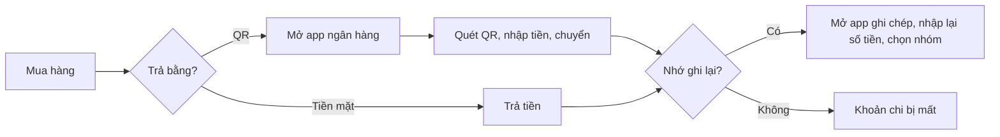
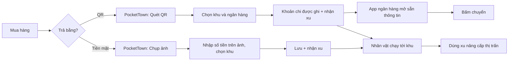

# PocketTown: Tài liệu Yêu cầu Nghiệp vụ (BRD)

| Mục | Nội dung |
|---|---|
| Sản phẩm | PocketTown, ứng dụng ghi chép chi tiêu cá nhân có thị trấn 3D |
| Phiên bản tài liệu | 1.0 |
| Ngày | 10/11/2026 |
| Trạng thái | Bản phát hành đầu tiên (MVP đã chạy trên iPhone qua Expo Go) |
| Tài liệu liên quan | [SRS](SRS.md) · [Thiết kế Figma](https://www.figma.com/design/DzLoLblVhyGTE3Xntfhcvo) |

## Mục lục
1. [Bối cảnh và vấn đề](#1-bối-cảnh-và-vấn-đề)
2. [Mục tiêu kinh doanh](#2-mục-tiêu-kinh-doanh)
3. [Các bên liên quan](#3-các-bên-liên-quan)
4. [Người dùng mục tiêu](#4-người-dùng-mục-tiêu)
5. [Phạm vi](#5-phạm-vi)
6. [Quy trình nghiệp vụ](#6-quy-trình-nghiệp-vụ)
7. [Yêu cầu nghiệp vụ](#7-yêu-cầu-nghiệp-vụ)
8. [Quy tắc nghiệp vụ](#8-quy-tắc-nghiệp-vụ)
9. [Giả định, ràng buộc và phụ thuộc](#9-giả-định-ràng-buộc-và-phụ-thuộc)
10. [Rủi ro](#10-rủi-ro)
11. [Tiêu chí thành công](#11-tiêu-chí-thành-công)
12. [Lộ trình](#12-lộ-trình)
13. [Nhật ký quyết định](#13-nhật-ký-quyết-định)

---

## 1. Bối cảnh và vấn đề

### 1.1 Bối cảnh
Người trẻ ở Việt Nam chi tiêu hằng ngày chủ yếu bằng hai cách: **chuyển khoản qua mã VietQR** và **trả tiền mặt**. Các app ghi chép chi tiêu hiện có đa phần là bảng biểu khô khan. Người dùng tải về, ghi được vài ngày rồi bỏ.

### 1.2 Vấn đề
| # | Vấn đề | Hệ quả |
|---|---|---|
| P1 | Ghi chi tiêu là việc nhàm chán, không có phần thưởng tức thì | Người dùng bỏ thói quen sau 1–2 tuần |
| P2 | Khi trả bằng QR, người dùng phải nhập lại số tiền ở hai nơi (app ngân hàng và app ghi chép) | Ghi thiếu, ghi sai |
| P3 | Khoản trả tiền mặt (trà sữa, gửi xe) dễ quên vì không để lại dấu vết | Tổng chi tháng thấp hơn thực tế |
| P4 | Nhiều app đòi đăng nhập hoặc liên kết tài khoản ngân hàng | Người dùng ngại lộ dữ liệu tài chính |
| P5 | Báo cáo dạng bảng số khó nhìn ra ngày nào, khoản nào tiêu nhiều | Không thay đổi được hành vi chi tiêu |

### 1.3 Ý tưởng giải pháp
PocketTown biến mỗi khoản chi thành một hành động trong trò chơi. Người dùng có một nhân vật sống trong thị trấn 3D. Mỗi khu trong thị trấn là một nhóm chi tiêu (Ăn uống, Mua sắm, Giải trí...). Ghi một khoản chi thì nhân vật chạy tới khu đó và người dùng nhận **xu**. Xu dùng để **nâng cấp nhà, mua xe, trồng cây**. Thị trấn lớn dần theo thói quen ghi chép.

Hai cách ghi nhanh được ưu tiên:
- **Quét QR chuyển khoản:** quét mã VietQR, chọn ngân hàng, app tự ghi khoản chi rồi mở app ngân hàng với thông tin đã điền sẵn.
- **Chụp ảnh khoản chi:** chụp món vừa mua, nhập số tiền ngay trên ảnh, chọn khu, lưu.

---

## 2. Mục tiêu kinh doanh

| Mã | Mục tiêu | Chỉ số đo (KPI) | Mức mong muốn |
|---|---|---|---|
| BO-1 | Tạo thói quen ghi chép hằng ngày | Tỉ lệ người dùng còn ghi chép sau 30 ngày (D30 retention) | ≥ 30% |
| BO-2 | Giảm công sức ghi một khoản chi | Thời gian trung bình để ghi một khoản | ≤ 10 giây (QR), ≤ 15 giây (ảnh) |
| BO-3 | Ghi đầy đủ hơn | Số khoản ghi trung bình mỗi người dùng mỗi ngày | ≥ 2 |
| BO-4 | Giúp người dùng hiểu thói quen chi tiêu | Tỉ lệ người dùng mở Báo cáo ít nhất 1 lần/tuần | ≥ 50% |
| BO-5 | Giữ niềm tin về quyền riêng tư | Số dữ liệu cá nhân gửi lên máy chủ | 0 (không có máy chủ) |

---

## 3. Các bên liên quan

| Vai trò | Trách nhiệm | Mức quan tâm |
|---|---|---|
| Chủ sản phẩm (Product Owner) | Quyết định phạm vi, ưu tiên tính năng, duyệt luật chơi | Cao |
| Business Analyst | Thu thập yêu cầu, viết BRD/SRS, thiết kế luồng và Figma | Cao |
| Nhà phát triển | Xây dựng app Expo/React Native, thị trấn 3D | Cao |
| Thiết kế 3D | Dựng nhà, nhân vật, xe trong Blender, xuất GLB | Trung bình |
| Người dùng cuối | Dùng app hằng ngày, phản hồi | Cao |
| Ngân hàng (bên ngoài) | Nhận deeplink chuyển khoản; không tích hợp trực tiếp | Thấp |
| Apple App Store | Duyệt app khi phát hành | Trung bình |

---

## 4. Người dùng mục tiêu

**Persona chính: "Mai", 21 tuổi, sinh viên năm 3 ở TP.HCM**
- Dùng iPhone, có 2 tài khoản ngân hàng (MBBank, Vietcombank).
- Mỗi ngày chi 3–5 khoản nhỏ: ăn sáng, trà sữa, gửi xe, Grab. Khoảng 60% trả bằng quét QR, 40% tiền mặt.
- Đã thử 2 app quản lý chi tiêu, bỏ sau 1 tuần vì "nhập mệt quá".
- Thích game nhẹ nhàng kiểu nuôi thú, xây nhà.
- Không muốn đăng ký tài khoản hay cho app đọc tài khoản ngân hàng.

**Nhu cầu chính**
1. Ghi khoản chi nhanh, ngay lúc trả tiền.
2. Có cái gì đó vui để muốn quay lại mỗi ngày.
3. Cuối tháng biết mình tiêu vào đâu nhiều nhất.
4. Dữ liệu nằm trên máy mình.

---

## 5. Phạm vi

### 5.1 Trong phạm vi (MVP)
| Mã | Hạng mục |
|---|---|
| S-1 | Chọn nhân vật (2 bạn nam, 2 bạn nữ), thú cưng (chó hoặc mèo), đặt tên |
| S-2 | Thị trấn 3D: nhà của người chơi, khu thú cưng, gara xe, 6 khu chi tiêu, tiệm hạt giống, vườn cây |
| S-3 | Ghi khoản chi bằng quét mã VietQR, chuyển sang app ngân hàng |
| S-4 | Ghi khoản chi bằng ảnh chụp (hoặc không ảnh) |
| S-5 | Tạo khu chi tiêu riêng (tối đa 4 khu, trên các lô đất trống) |
| S-6 | Xem, lọc, xoá khoản chi theo khu |
| S-7 | Hệ thống xu: nhận xu khi ghi, trừ xu khi xoá |
| S-8 | Nâng cấp nhà ở mỗi khu (cấp 1–7), mua xe (4 loại) |
| S-9 | Vườn cây: mua hạt, trồng, thu hoạch |
| S-10 | Báo cáo tháng: tổng chi, dự kiến cả tháng, phân bổ theo khu, lịch "Đầu tư" |
| S-11 | Ghi nhận tiền nhận vào từ tin nhắn ngân hàng (không tính là chi tiêu) |
| S-12 | Cài đặt: âm thanh, ngân hàng mặc định, sao lưu và khôi phục dữ liệu bằng file |

### 5.2 Ngoài phạm vi
| Hạng mục | Lý do |
|---|---|
| Thanh toán hay giữ tiền thật | App chỉ ghi chép; không phải ví điện tử |
| Kết nối API ngân hàng, đọc số dư | Cần giấy phép, rủi ro bảo mật |
| Tài khoản, đăng nhập, máy chủ | Dữ liệu chỉ nằm trên máy (BO-5) |
| Đồng bộ nhiều thiết bị | Thay bằng sao lưu file |
| Ghi thu nhập như một khoản chi | Thu nhập tách riêng ở mục Tiền nhận vào |
| Ngân sách và mục tiêu tiết kiệm | Để phiên bản sau |
| Android | Giai đoạn đầu chỉ thử trên iPhone (công nghệ đã hỗ trợ Android) |

---

## 6. Quy trình nghiệp vụ

### 6.1 Quy trình hiện tại (chưa có PocketTown)

### 6.2 Quy trình mới với PocketTown

---

## 7. Yêu cầu nghiệp vụ

Mức ưu tiên theo MoSCoW: **M** = bắt buộc, **S** = nên có, **C** = có thì tốt.

| Mã | Yêu cầu | Ưu tiên | Mục tiêu liên quan |
|---|---|---|---|
| BR-01 | Người dùng vào app là dùng được ngay, không cần đăng ký | M | BO-1, BO-5 |
| BR-02 | Người dùng có nhân vật và thú cưng riêng trong một thị trấn 3D | M | BO-1 |
| BR-03 | Người dùng ghi được khoản chi chuyển khoản bằng cách quét mã VietQR, không nhập lại số tiền | M | BO-2, BO-3 |
| BR-04 | Sau khi quét, app mở app ngân hàng người dùng chọn với thông tin chuyển khoản đã có sẵn (nếu ngân hàng hỗ trợ) | M | BO-2 |
| BR-05 | Người dùng ghi được khoản trả tiền mặt kèm ảnh chụp | M | BO-3 |
| BR-06 | Mỗi khoản chi thuộc đúng một khu chi tiêu; người dùng tạo thêm được khu riêng | M | BO-4 |
| BR-07 | Người dùng nhận phần thưởng (xu) ngay khi ghi, và mất phần thưởng khi xoá khoản đó | M | BO-1 |
| BR-08 | Người dùng dùng xu để nâng cấp công trình, mua xe, trồng cây | M | BO-1 |
| BR-09 | Người dùng xem lại và xoá các khoản chi theo từng khu, theo tháng | M | BO-4 |
| BR-10 | Người dùng xem báo cáo tháng: tổng chi, dự kiến, phân bổ theo khu, lịch theo ngày | M | BO-4 |
| BR-11 | Người dùng ghi được tiền nhận vào từ tin nhắn ngân hàng mà không làm sai tổng chi tiêu | S | BO-4 |
| BR-12 | Người dùng chuyển dữ liệu sang máy mới bằng file sao lưu | S | BO-5 |
| BR-13 | Mọi dữ liệu, kể cả ảnh, chỉ lưu trên điện thoại | M | BO-5 |
| BR-14 | Có âm thanh và hiệu ứng khi bấm, nhận xu; người dùng tắt được âm thanh | C | BO-1 |

---

## 8. Quy tắc nghiệp vụ

| Mã | Quy tắc |
|---|---|
| RULE-01 | Xu thưởng cho mỗi khoản chi = 5 + 1 xu cho mỗi 10.000đ, tối đa 50 xu một khoản. Ví dụ: 25.000đ → 7 xu; 1.200.000đ → 50 xu. |
| RULE-02 | Khoản chi có ảnh được thêm 10 xu. Tổng xu thưởng ảnh tối đa 50 xu mỗi ngày. Số ảnh không giới hạn. |
| RULE-03 | Sửa số tiền thì xu được tính lại; app báo trước chênh lệch ("+3 xu" hoặc "-2 xu"). |
| RULE-04 | Xoá khoản chi thì trừ toàn bộ xu khoản đó đã nhận. Số xu không bao giờ âm. |
| RULE-05 | Khoản chuyển khoản được ghi ngay khi mở app ngân hàng. App không hỏi lại "đã chuyển chưa"; nếu người dùng không chuyển thì tự xoá khoản đó. |
| RULE-06 | Nâng cấp phải mua theo thứ tự (cấp N cần cấp N-1). Không đủ xu thì không mua được. |
| RULE-07 | Giá nâng cấp công trình cấp 2 đến 7: 100, 250, 400, 600, 850, 1.150 xu. Xe: Xe đạp 40, Xe máy 80, Ô tô 200, Siêu xe 500 xu. |
| RULE-08 | Hạt giống: Hướng dương 10 xu (30 phút), Tulip 15 xu (2 giờ), Cà chua 20 xu (6 giờ), Cây táo 40 xu (24 giờ). |
| RULE-09 | Tiền nhận vào không tính là chi tiêu, không được xu, không hiện trên lịch Đầu tư. |
| RULE-10 | Chỉ có một lịch: lịch "Đầu tư". Ngày càng chi nhiều thì ô càng đậm. |
| RULE-11 | Số tiền là số nguyên đồng, từ 1đ đến 999.999.999đ. |
| RULE-12 | Thị trấn có 4 lô đất trống cho khu tự tạo. Hết lô thì không tạo thêm được. |

---

## 9. Giả định, ràng buộc và phụ thuộc

**Giả định**
- A1. Người dùng có iPhone và đã cài ít nhất một app ngân hàng Việt Nam.
- A2. Mã QR chuyển khoản theo chuẩn VietQR (NAPAS 247).
- A3. Người dùng tự bấm chuyển tiền trong app ngân hàng sau khi PocketTown mở app đó.

**Ràng buộc**
- C1. Không có máy chủ, không thu thập dữ liệu.
- C2. Nhóm phát triển dùng máy Windows, không có Mac: app phải chạy thử được qua Expo Go và build iOS trên đám mây (EAS).
- C3. iOS không cho app đọc thông báo của app khác, nên tiền nhận vào chỉ đọc được qua dán tin nhắn hoặc Phím tắt (Shortcuts) với SMS.
- C4. Thị trấn 3D phải chạy mượt (mục tiêu 60 khung hình/giây) trên iPhone tầm trung.

**Phụ thuộc**
- D1. Đường dẫn mở app ngân hàng (deeplink) của từng ngân hàng. Một số ngân hàng không nhận thông tin điền sẵn.
- D2. Bộ mô hình 3D tạo bằng Blender và xuất GLB.

---

## 10. Rủi ro

| Mã | Rủi ro | Khả năng | Ảnh hưởng | Cách giảm |
|---|---|---|---|---|
| R1 | Ngân hàng đổi hoặc bỏ deeplink | Trung bình | Cao | Ngân hàng không tự điền: tạo mã QR có sẵn số tiền, lưu vào Ảnh để người dùng quét trong app ngân hàng; có thẻ "chép từng dòng" |
| R2 | Người dùng ghi khoản chi giả để lấy xu | Cao | Thấp | Giới hạn 50 xu/khoản, 50 xu ảnh/ngày; app cá nhân nên không ảnh hưởng người khác |
| R3 | Mất điện thoại là mất dữ liệu | Trung bình | Cao | Sao lưu file JSON; hoàn tác lần khôi phục |
| R4 | 3D chạy chậm trên máy yếu | Trung bình | Trung bình | Gộp lưới, màu phẳng, không đổ bóng; phương án dự phòng Godot 4 |
| R5 | Game hoá làm người dùng chi nhiều hơn để lấy xu | Thấp | Trung bình | Xu tăng chậm theo số tiền (tối đa 50), thưởng chủ yếu cho việc ghi, không cho việc tiêu nhiều |

---

## 11. Tiêu chí thành công

MVP được coi là đạt khi:
1. Quét một mã VietQR thật, chọn ngân hàng, app ngân hàng mở ra với đúng người nhận và số tiền (với ngân hàng hỗ trợ).
2. Ghi một khoản bằng ảnh mất dưới 15 giây.
3. Xu cộng và trừ đúng theo RULE-01 đến RULE-04 (có kiểm thử tự động).
4. Thị trấn 3D chạy 60 khung hình/giây trên iPhone thử nghiệm.
5. Sao lưu rồi khôi phục trên máy khác giữ nguyên khoản chi, xu, cấp nhà, xe, vườn.
6. Người dùng thử ghi chép liên tục 14 ngày.

---

## 12. Lộ trình

| Giai đoạn | Nội dung | Trạng thái |
|---|---|---|
| 0. Khám phá | Ý tưởng, chọn công nghệ (Swift → Expo vì không có Mac) | Xong (10/2026) |
| 1. Thị trấn 3D | Dựng thị trấn, nhân vật, thú cưng; kiểm tra 60 fps trên iPhone | Xong (10/2026) |
| 2. Ghi chép | Chụp ảnh, quét QR, deeplink ngân hàng, khu tự tạo | Xong (10–11/2026) |
| 3. Phần thưởng | Xu, nâng cấp cấp 1–7, xe, vườn cây | Xong (11/2026) |
| 4. Báo cáo và dữ liệu | Báo cáo tháng, lịch Đầu tư, tiền nhận vào, sao lưu | Xong (11/2026) |
| 5. Thiết kế lại | Figma đầy đủ luồng, BRD, SRS | Xong (11/2026) |
| 6. Phát hành | Build EAS, TestFlight, thử với 10 người dùng | Kế hoạch |
| 7. Mở rộng | Ngân sách tháng, quần áo thú cưng, cấp 8–10, Android, sao lưu ảnh | Kế hoạch |

---

## 13. Nhật ký quyết định

| Ngày | Quyết định | Lý do |
|---|---|---|
| 19/10/2026 | Chỉ có một lịch, gọi là "Đầu tư" | Tránh rối; "chi cho bản thân là đầu tư" |
| 20/10/2026 | Đổi từ Swift sang Expo (React Native) + Three.js | Không có Mac; chạy thử trên iPhone qua Expo Go |
| 20/10/2026 | Không hỏi "đã chuyển tiền chưa" sau khi mở app ngân hàng | Giảm thao tác; khoản sai thì xoá |
| 20/10/2026 | Xu = 5 + 1/10.000đ, tối đa 50; ảnh +10, tối đa 50/ngày | Thưởng việc ghi chép, chặn lạm dụng |
| 23/10/2026 | Làm lại thế giới thành thị trấn (không phải đảo) | Dễ hiểu, có đường phố, có chỗ cho xe và vườn |
| 03/11/2026 | Bỏ hẳn đăng nhập; thêm sao lưu bằng file | Không cần tài khoản; dữ liệu của người dùng nằm trên máy họ |
| 03/11/2026 | Mỗi công trình lên tới cấp 7 | Đủ mục tiêu dài hạn với số mô hình 3D hiện có |
