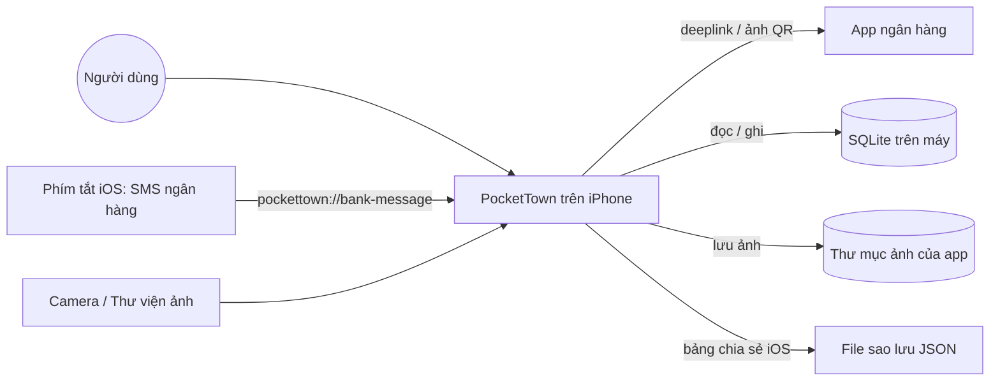
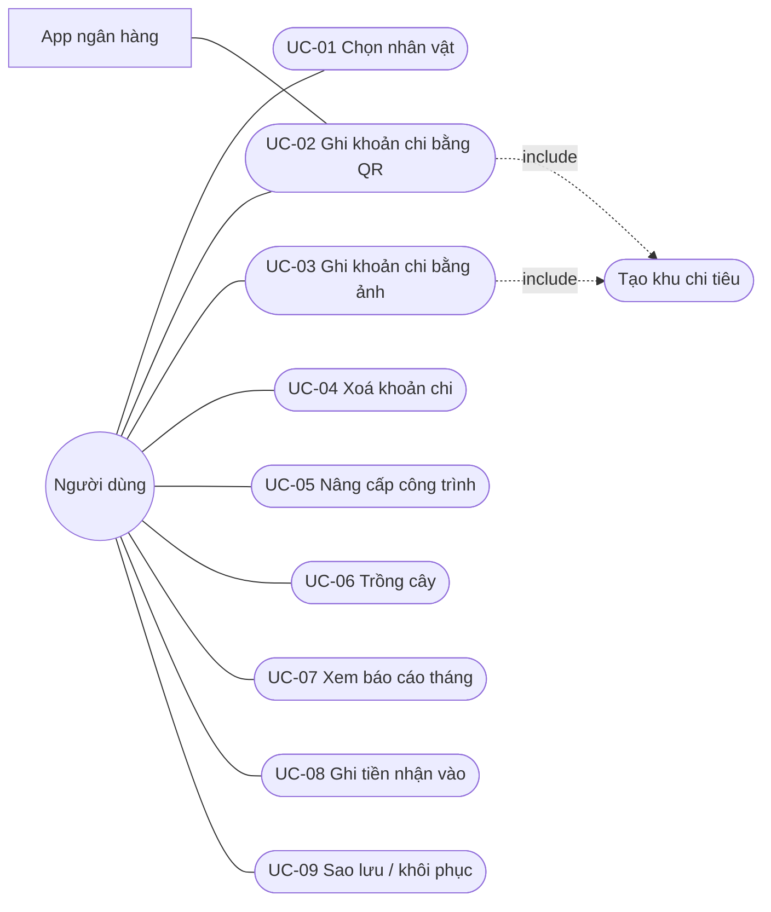
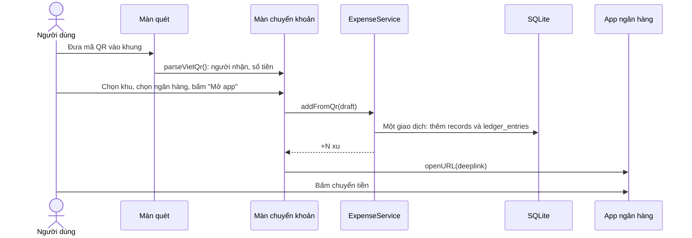
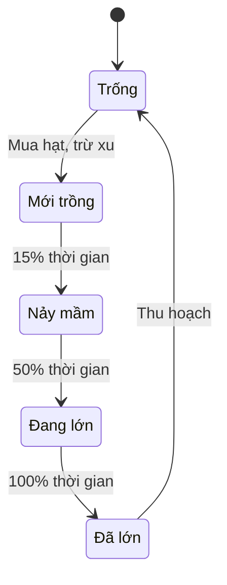
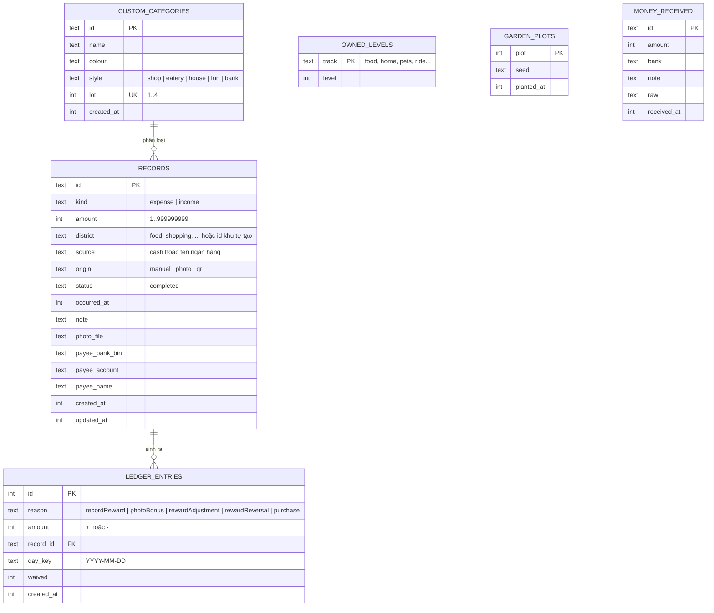

# PocketTown: Đặc tả Yêu cầu Phần mềm (SRS)

| Mục | Nội dung |
|---|---|
| Sản phẩm | PocketTown (iOS, Expo / React Native) |
| Phiên bản tài liệu | 1.0 |
| Ngày | 10/11/2026 |
| Chuẩn tham khảo | IEEE 830 / ISO/IEC/IEEE 29148 (rút gọn) |
| Tài liệu liên quan | [BRD](BRD.md) · [Thiết kế Figma có prototype](https://www.figma.com/design/DzLoLblVhyGTE3Xntfhcvo) |

## Mục lục
1. [Giới thiệu](#1-giới-thiệu)
2. [Mô tả tổng quan](#2-mô-tả-tổng-quan)
3. [Yêu cầu chức năng](#3-yêu-cầu-chức-năng)
4. [Đặc tả ca sử dụng chính](#4-đặc-tả-ca-sử-dụng-chính)
5. [Yêu cầu dữ liệu](#5-yêu-cầu-dữ-liệu)
6. [Yêu cầu giao diện](#6-yêu-cầu-giao-diện)
7. [Yêu cầu phi chức năng](#7-yêu-cầu-phi-chức-năng)
8. [Ma trận truy vết](#8-ma-trận-truy-vết)
9. [Tiêu chí nghiệm thu](#9-tiêu-chí-nghiệm-thu)
10. [Phụ lục](#10-phụ-lục)

---

## 1. Giới thiệu

### 1.1 Mục đích
Tài liệu mô tả đầy đủ yêu cầu chức năng và phi chức năng của PocketTown phiên bản MVP, làm căn cứ để phát triển, kiểm thử và nghiệm thu. Người đọc: chủ sản phẩm, nhà phát triển, kiểm thử viên, thiết kế.

### 1.2 Phạm vi sản phẩm
PocketTown là ứng dụng ghi chép chi tiêu cá nhân trên iPhone. Mỗi khoản chi đưa nhân vật tới một khu trong thị trấn 3D và thưởng xu. Xu dùng để nâng cấp thị trấn. App **không** giữ tiền, **không** thanh toán, **không** kết nối tài khoản ngân hàng, **không** có máy chủ.

### 1.3 Thuật ngữ
| Thuật ngữ | Nghĩa |
|---|---|
| Khoản chi (record) | Một lần chi tiền người dùng ghi lại |
| Khu (district) | Nhóm chi tiêu, hiện là một công trình trong thị trấn (Ăn uống, Mua sắm...) |
| Khu tự tạo | Khu chi tiêu người dùng tạo thêm, xây trên lô đất trống |
| Xu | Đơn vị phần thưởng trong app, không phải tiền |
| Sổ xu (ledger) | Danh sách mọi lần cộng/trừ xu; số dư = tổng sổ |
| VietQR | Chuẩn mã QR chuyển khoản liên ngân hàng của NAPAS |
| Deeplink | Đường dẫn mở thẳng một màn hình trong app khác |
| Tự điền (autofill) | Ngân hàng nhận người nhận, số tiền, nội dung qua deeplink |
| Lịch Đầu tư | Lịch tháng duy nhất của app; ô càng đậm là ngày chi càng nhiều |
| Lớp phủ (overlay) | Bảng trượt lên che một phần màn hình |

---

## 2. Mô tả tổng quan

### 2.1 Bối cảnh hệ thống

### 2.2 Chức năng chính
1. Khởi tạo người chơi (nhân vật, thú cưng, tên).
2. Thị trấn 3D tương tác.
3. Ghi khoản chi bằng QR hoặc bằng ảnh.
4. Quản lý khu chi tiêu và các khoản chi.
5. Xu, nâng cấp, xe, vườn cây.
6. Báo cáo tháng và tiền nhận vào.
7. Cài đặt, sao lưu và khôi phục.

### 2.3 Lớp người dùng
Chỉ có **một** lớp người dùng: chủ máy. Không có quản trị viên, không có tài khoản.

### 2.4 Môi trường vận hành
| Hạng mục | Giá trị |
|---|---|
| Thiết bị | iPhone (phiên bản iOS mà Expo SDK 58 hỗ trợ) |
| Khung ứng dụng | Expo SDK 58, React Native 0.88, TypeScript |
| 3D | Three.js trên expo-gl, mô hình GLB |
| Lưu trữ | expo-sqlite (dữ liệu), kv-store (cài đặt), thư mục tài liệu của app (ảnh) |
| Camera, QR | expo-camera, expo-image-picker |
| Phát triển | Windows, chạy thử bằng Expo Go; build iOS bằng EAS |

### 2.5 Ràng buộc thiết kế
- Toàn bộ giao diện tiếng Việt, tiền tệ VND, tuần bắt đầu thứ Hai.
- Phần logic nghiệp vụ (`src/domain`) không phụ thuộc React, Expo, SQLite hay Three.js, để kiểm thử bằng Jest.
- Chỉ dùng thư viện chạy được trong Expo Go.

### 2.6 Giả định
Xem [BRD mục 9](BRD.md#9-giả-định-ràng-buộc-và-phụ-thuộc).

---

## 3. Yêu cầu chức năng

Mỗi yêu cầu có mã `FR-xx`, ưu tiên (M/S/C), và màn hình Figma tương ứng (mã khung như A1, B3...).

### 3.1 Khởi tạo người chơi
| Mã | Yêu cầu | Ưu tiên | Màn hình |
|---|---|---|---|
| FR-01 | Lần đầu mở app, hệ thống hiển thị màn hình "Chào mừng tới PocketTown!" để chọn 1 trong 4 nhân vật (Bạn nam, Bạn nữ, Bạn nam tóc đen, Bạn nữ tóc vàng) và 1 trong 2 thú cưng (Cún con, Mèo con). | M | A1 |
| FR-02 | Người dùng nhập tên nhân vật và tên thú cưng, mỗi tên tối đa 16 ký tự, có bộ đếm "x/16". Tên có thể để trống. | S | A1 |
| FR-03 | Bấm "Vào thị trấn" lưu lựa chọn và mở thị trấn. Những lần mở sau vào thẳng thị trấn. | M | A1 → A2 |
| FR-04 | Người dùng đổi nhân vật, thú cưng, tên từ chip góc trái thị trấn hoặc Cài đặt; có nút "Lưu" và "Huỷ". | S | A7 |

### 3.2 Thị trấn
| Mã | Yêu cầu | Ưu tiên | Màn hình |
|---|---|---|---|
| FR-05 | Thị trấn 3D gồm: Nhà của bạn, Khu thú cưng, Khu xe cộ (gara), 6 khu chi tiêu, Tiệm hạt giống, Vườn cây, 4 lô đất trống. Mỗi nơi có nhãn tên nổi. | M | A2, A2b |
| FR-06 | Khi mở, nhân vật tự đi dạo trên đường. Người dùng kéo để xoay, chụm để phóng to/thu nhỏ trong giới hạn. | M | A2 ↔ A2b |
| FR-07 | Chạm một công trình: công trình nảy lên, phát âm thanh, nhân vật chạy tới, camera tiến vào cửa và mở màn hình khu đó (FR-24). | M | A2 → D1, D8, D10, D13... |
| FR-08 | Góc phải trên hiển thị số xu hiện có. | M | A2 |
| FR-09 | Sau khi lưu một khoản chi, thị trấn hiện thông báo "Đã ghi khoản chi, +N xu" và nhân vật đi tới khu của khoản đó. | M | A3 |
| FR-10 | Thanh menu dưới có 5 mục: Thế giới, Chụp ảnh, Quét QR (nút nổi ở giữa), Báo cáo, Cài đặt. | M | Mọi màn chính |

### 3.3 Ghi khoản chi bằng quét QR
| Mã | Yêu cầu | Ưu tiên | Màn hình |
|---|---|---|---|
| FR-11 | Màn quét hiển thị camera, khung quét, gợi ý "Đưa mã QR chuyển khoản vào khung", nút "Chọn ảnh" (đọc QR từ ảnh trong album), nút "Đóng", và tab chuyển sang "Chụp ảnh". | M | C1 |
| FR-12 | Chưa có quyền camera: hiện "PocketTown cần camera để quét mã QR chuyển khoản.", nút "Cho phép dùng camera", và gợi ý chọn ảnh từ album. | M | C1b |
| FR-13 | Đọc được mã VietQR (EMVCo): mã ngân hàng (BIN), số tài khoản, tên người nhận, số tiền (nếu có), nội dung. Mã không phải VietQR thì báo lỗi và tiếp tục quét. | M | C1 → C2 |
| FR-14 | Màn "Chuyển khoản" hiển thị: Người nhận (tên, số tài khoản · ngân hàng), Số tiền (bấm để sửa bằng bàn phím số), Nội dung (không bắt buộc), Khu chi tiêu (chọn 1, có "+ Thêm khu"), Ngân hàng trả tiền (18 ngân hàng). | M | C2, C5 |
| FR-15 | Ngân hàng hỗ trợ tự điền có dấu ⚡ và gợi ý "{bank} tự điền người nhận, số tiền và nội dung. Bạn chỉ cần bấm chuyển." | M | C2 |
| FR-16 | Ngân hàng không hỗ trợ tự điền: app tạo mã QR mới có sẵn số tiền, hiển thị khung "Mã QR mang sang {bank}" và hướng dẫn. Khi bấm mở app, mã được lưu vào Ảnh. | M | C3 |
| FR-17 | Bấm "Mở app {bank}": hệ thống ghi khoản chi (trạng thái hoàn tất, origin = qr, kèm thông tin người nhận), cộng xu, hiện màn chờ "Đang mở {bank}…", rồi mở app ngân hàng. | M | C4 |
| FR-18 | Không mở được app ngân hàng: hiện "Không mở được app {bank}. Bạn đã cài app này chưa?" và giữ nguyên dữ liệu đã nhập. | M | C6 |
| FR-19 | Với ngân hàng không tự điền, khi quay lại thị trấn hiện thẻ "Quét ảnh QR trong {bank}" với 3 dòng Số tài khoản, Số tiền, Nội dung; mỗi dòng có nút "Chép" đổi thành "Đã chép". | S | A6 |
| FR-20 | Ghi nhớ ngân hàng chọn lần trước làm ngân hàng mặc định. | S | C2, F2 |

### 3.4 Ghi khoản chi bằng ảnh
| Mã | Yêu cầu | Ưu tiên | Màn hình |
|---|---|---|---|
| FR-21 | Màn chụp "Chụp khoản chi" có nút chụp, đổi camera trước/sau, "Bỏ qua ảnh", "Đóng", tab "Quét QR". Chưa có quyền camera thì hiện thông báo và nút cho phép. | M | B1, B2 |
| FR-22 | Sau khi chụp (hoặc bỏ qua ảnh), màn "Khoản chi có ảnh" / "Khoản chi" hiển thị ảnh vuông với số tiền nổi trên ảnh (bấm để nhập), chọn khu, "Ghi chú" (không bắt buộc), nút "Lưu", và dòng nhắc thưởng ảnh. | M | B3, B6, B4 |
| FR-23 | Bấm "Lưu": kiểm tra số tiền hợp lệ (FR-49), lưu khoản chi, lưu ảnh (cạnh dài tối đa 1080 px) vào máy, cộng xu theo RULE-01, RULE-02, quay về thị trấn (FR-09). | M | B3 → A3 |

### 3.5 Khu chi tiêu và khoản chi
| Mã | Yêu cầu | Ưu tiên | Màn hình |
|---|---|---|---|
| FR-24 | Màn một khu có mái hiên màu của khu, tên, huy hiệu cấp, nút đóng, và 2 tab: "Chi tiêu" (khu chi tiêu) hoặc "Giới thiệu" (khu không phải chi tiêu), và "Nâng cấp". | M | D1, D8 |
| FR-25 | Tab Chi tiêu: đổi tháng (Tháng trước / Tháng sau, không vượt tháng hiện tại), tổng "Đã chi cho {khu}", số khoản, danh sách khoản (ảnh nhỏ, ghi chú, ngày giờ, số tiền). | M | D1 |
| FR-26 | Chuyển giữa xem danh sách và xem lưới ảnh 3 cột. | S | D1 ↔ D2 |
| FR-27 | Chạm ảnh của khoản chi mở ảnh lớn, phóng to bằng hai ngón. | S | D5 |
| FR-28 | Chế độ "Chọn": chạm để chọn nhiều khoản, hiện "Đã chọn N khoản", nút "Xoá (N)". Xác nhận "Xoá khoản này?" kèm tổng tiền và số xu bị trừ. | M | D3, D4 |
| FR-29 | Tháng chưa có khoản nào: hiện "Tháng này chưa có khoản nào ở đây". | M | D14 |
| FR-30 | Tạo khu chi tiêu mới: Tên khu (bắt buộc), Màu (11 màu), Kiểu nhà (Cửa hàng, Quán, Nhà, Khu vui chơi, Ngân hàng), nút "Xây khu này". Khu mới được xây trên lô trống tiếp theo. | S | B5 |
| FR-31 | Hết 4 lô trống: hiện "Thị trấn đã kín 4 lô đất trống…" và nút "Đã hiểu". | S | B5 |
| FR-32 | Khu tự tạo: tab Nâng cấp hiện thẻ "Sắp có" và thẻ "Xoá khu này" (xác nhận "Xoá khu "X"?"). Khoản chi đã ghi vẫn còn trong Báo cáo. | S | D11, D12 |
| FR-33 | Khu xe cộ, Khu thú cưng, Tiệm hạt giống có tab Giới thiệu giải thích nơi đó dùng để làm gì và dòng "Chi tiêu không được ghi ở đây: nơi này chỉ để ghé chơi và nâng cấp." | M | D8, D10 |

### 3.6 Xu và nâng cấp
| Mã | Yêu cầu | Ưu tiên | Màn hình |
|---|---|---|---|
| FR-34 | Hệ thống tính xu thưởng theo RULE-01, RULE-02, ghi vào sổ xu. Mỗi khoản chi có tối đa một bút toán thưởng, một thưởng ảnh, một bút toán hoàn (khoá duy nhất `record_id + reason`). | M | — |
| FR-35 | Xoá khoản chi: ghi bút toán hoàn bằng toàn bộ xu khoản đó đã nhận; nếu số dư không đủ thì trừ về 0 và ghi phần được miễn. | M | D4, E4 |
| FR-36 | Tab Nâng cấp: hiện "Bạn có N xu" và các thẻ cấp (ảnh, "Cấp N", tên, mô tả). Cấp đã có gắn nhãn "Đã có". Cấp kế tiếp có nút "Mua với N xu". | M | D6 |
| FR-37 | Không đủ xu: nút mờ và dòng "Còn thiếu N xu. Ghi thêm chi tiêu để nhận xu." Cấp chưa tới lượt: "N xu, mở sau cấp N-1." | M | D7, D6 |
| FR-38 | Mua thành công: trừ xu và lưu cấp mới trong cùng một giao dịch, hiện "Đã lên cấp N: {tên}. Bạn trả N xu." (xe: "{xe} đã về gara"). Thị trấn thay mô hình 3D tương ứng. | M | D7, D9b |
| FR-39 | Gara bắt đầu trống, hiện "Gara còn trống" và nút "Mua xe đầu tiên". Sau khi mua, nhân vật đi bằng xe đó (xe đạp 4,5 m/s, xe máy 6, ô tô 8, siêu xe 10). | M | D8, D9 |

### 3.7 Vườn cây
| Mã | Yêu cầu | Ưu tiên | Màn hình |
|---|---|---|---|
| FR-40 | Chạm ô đất trống trong vườn mở thẻ "Ô đất số N" với số xu và 4 hạt giống (RULE-08). Mua hạt trừ xu và trồng ngay. | S | A4 |
| FR-41 | Cây lớn theo 4 giai đoạn (mới trồng, nảy mầm 15%, đang lớn 50%, đã lớn 100%) hiển thị bằng thanh tiến độ và mô hình 3D. | S | A5 |
| FR-42 | Cây đã lớn có nút "Thu hoạch" để giải phóng ô đất; thông báo "Thu hoạch xong…". | S | A5 |

### 3.8 Báo cáo
| Mã | Yêu cầu | Ưu tiên | Màn hình |
|---|---|---|---|
| FR-43 | Báo cáo tháng (đổi tháng Trước / Sau): thẻ tổng gồm "Tổng chi tháng này", "Dự kiến cả tháng", "Trung bình/ngày", "Cao nhất (dd/mm)", "Ngày có chi". | M | E1 |
| FR-44 | "Chi cho gì": phân bổ theo khu (số tiền, %, thanh ngang). Chạm một khu để lọc danh sách khoản theo khu đó, có "Bỏ lọc". | M | E1 → E2 |
| FR-45 | "Lịch Đầu tư": lịch tháng, thứ Hai đầu tuần, 4 mức đậm theo tỉ lệ so với ngày chi nhiều nhất của tháng (≤25%, ≤50%, ≤75%, >75%), chú thích "Ít – Nhiều". Chạm một ngày để lọc theo ngày. | M | E1 → E2b |
| FR-46 | Chạm một khoản mở bảng chi tiết: ảnh, khu, số tiền, ghi chú, Thời gian, Nguồn tiền, Cách ghi (Tự nhập / Chụp ảnh / Quét QR), Người nhận (nếu QR); nút "Xong" và "Xoá khoản này". | M | E3, E4 |
| FR-47 | "Tiền nhận vào": danh sách tiền nhận, ghi chú "Không tính vào chi tiêu và không nhận xu.", nút "Dán tin nhắn ngân hàng". App đọc tin nhắn, hiện "PocketTown đọc được" (số tiền, người gửi, nội dung, thời gian) với "Huỷ" / "Lưu". Chỉ nhận tin có dấu "+"; tin trùng trong 10 phút bị bỏ qua. | S | E5, E5b |
| FR-48 | Mở đường dẫn `pockettown://bank-message?text=…` (từ Phím tắt iOS) thì tự đọc và lưu tiền nhận vào như FR-47. | C | F3 |

### 3.9 Kiểm tra dữ liệu chung
| Mã | Yêu cầu | Ưu tiên |
|---|---|---|
| FR-49 | Số tiền là số nguyên từ 1 đến 999.999.999 đồng. Bàn phím số có 1–9, 000, 0, xoá lùi và "Xong". | M |
| FR-50 | Ghi chú tối đa 200 ký tự; tên khu, tên nhân vật, tên thú cưng tối đa 16 ký tự. | S |

### 3.10 Cài đặt, sao lưu, khôi phục
| Mã | Yêu cầu | Ưu tiên | Màn hình |
|---|---|---|---|
| FR-51 | Cài đặt hiển thị: Tên, nhân vật và thú cưng; Số xu; Âm thanh (bật/tắt); Ngân hàng mặc định (mở danh sách để chọn); Tự ghi tiền nhận vào; Sao lưu dữ liệu; Khôi phục từ file; Về PocketTown, Phiên bản. | M | F1, F2 |
| FR-52 | "Tự ghi tiền nhận vào" mở bảng hướng dẫn 5 bước tạo Phím tắt iOS, dòng đường dẫn có nút chép, nút "Xong". | C | F3 |
| FR-53 | "Sao lưu dữ liệu" tạo file `PocketTown_SaoLuu_YYYY-MM-DD.json` (khoản chi, sổ xu, khu tự tạo, cấp nâng cấp, vườn, tiền nhận vào, nhân vật, cài đặt, phiên bản dữ liệu) và mở bảng chia sẻ iOS. Ảnh không nằm trong file. | S | F5 |
| FR-54 | "Khôi phục từ file": chọn file, kiểm tra định dạng, hỏi lại "Khôi phục dữ liệu?" với ngày sao lưu, số khoản chi, số xu, và cảnh báo dữ liệu hiện có sẽ bị thay thế. | S | F4 |
| FR-55 | Trước mỗi lần khôi phục, app giữ bản dự phòng dữ liệu hiện tại (5 bản gần nhất). Sau khi khôi phục hiện "Hoàn tác lần khôi phục". | S | F6 |

---

## 4. Đặc tả ca sử dụng chính

> **Bản đặc tả đầy đủ:** 15 use case theo mẫu 13 trường (Wiegers/IIBA), có luồng chính, luồng thay thế, ngoại lệ và bảng chấm 20 tiêu chí, nằm ở [use-cases/README.md](use-cases/README.md) (tiếng Anh). Phần dưới đây là tóm tắt các ca chính.

### 4.1 Sơ đồ ca sử dụng

### 4.2 UC-02 Ghi khoản chi bằng quét QR
| Mục | Nội dung |
|---|---|
| Tác nhân | Người dùng; App ngân hàng (phụ) |
| Tiền điều kiện | Đã qua bước chọn nhân vật |
| Hậu điều kiện thành công | Có 1 khoản chi origin = qr; sổ xu có 1 bút toán thưởng; app ngân hàng được mở |
| Kích hoạt | Bấm nút Quét QR ở thanh menu |

**Luồng chính**
1. Hệ thống mở camera và khung quét (C1).
2. Người dùng đưa mã VietQR vào khung.
3. Hệ thống đọc mã, mở màn Chuyển khoản (C2) với người nhận và số tiền điền sẵn.
4. Người dùng chọn khu chi tiêu và ngân hàng trả tiền.
5. Người dùng bấm "Mở app {bank}".
6. Hệ thống lưu khoản chi và cộng xu trong một giao dịch.
7. Hệ thống mở app ngân hàng qua deeplink, kèm người nhận, số tiền, nội dung (C4).
8. Người dùng bấm chuyển tiền trong app ngân hàng (ngoài PocketTown).
9. Khi quay lại, thị trấn hiện "+N xu" và nhân vật đi tới khu (A3).

**Luồng thay thế**
- 2a. Người dùng bấm "Chọn ảnh", chọn ảnh có mã QR. Tiếp bước 3.
- 3a. Mã QR không có số tiền: ô Số tiền hiện "Bấm để nhập số tiền". Người dùng phải nhập trước khi bước 5 được bật.
- 4a. Người dùng chọn "+ Thêm khu" → tạo khu mới (FR-30) → khu mới được chọn.
- 4b. Ngân hàng không tự điền: hiện mã QR mang sang (C3). Ở bước 7, mã được lưu vào Ảnh rồi mở app ngân hàng; khi quay lại hiện thẻ chép từng dòng (A6).

**Luồng ngoại lệ**
- 1a. Chưa có quyền camera → C1b.
- 3b. Mã không phải VietQR → báo lỗi, quay lại bước 2.
- 7a. Không mở được app ngân hàng → hiện lỗi (C6), khoản chi chưa được ghi.

### 4.3 UC-03 Ghi khoản chi bằng ảnh
| Mục | Nội dung |
|---|---|
| Tiền điều kiện | Đã qua bước chọn nhân vật |
| Hậu điều kiện | Có 1 khoản chi origin = photo; ảnh lưu trong máy; xu thưởng (+10 nếu có ảnh và chưa chạm 50 xu ảnh trong ngày) |

**Luồng chính**
1. Người dùng bấm "Chụp ảnh" ở thanh menu (B1).
2. Người dùng chụp ảnh món đã mua.
3. Hệ thống hiện màn "Khoản chi có ảnh" (B3).
4. Người dùng bấm vào số tiền, nhập bằng bàn phím số (B4), bấm "Xong".
5. Người dùng chọn khu, nhập ghi chú (tuỳ chọn), bấm "Lưu".
6. Hệ thống lưu khoản chi, ảnh và xu; mở thị trấn với thông báo (A3).

**Luồng thay thế**
- 2a. Bấm "Bỏ qua ảnh" → màn "Khoản chi" không ảnh (B6), không có thưởng ảnh.
- 3a. Bấm "Chụp lại" → quay về B1.
- 6a. Đã nhận đủ 50 xu ảnh trong ngày → khoản vẫn được lưu với ảnh, không cộng thêm 10 xu.

### 4.4 UC-04 Xoá khoản chi
1. Người dùng mở một khu (D1), bấm "Chọn" (D3), chạm các khoản muốn xoá.
2. Bấm "Xoá (N)". Hệ thống hỏi "Xoá khoản này?" kèm tổng tiền và "Bạn sẽ bị trừ N xu." (D4).
3. Bấm "Xoá": hệ thống xoá khoản, xoá ảnh, ghi bút toán hoàn xu, cập nhật tổng.
- 1a. Xoá từ Báo cáo: chạm khoản → bảng chi tiết (E3) → "Xoá khoản này" → xác nhận (E4).
- 2a. Bấm "Huỷ": không thay đổi gì.

### 4.5 UC-05 Nâng cấp công trình
1. Người dùng chạm công trình trong thị trấn, chọn tab "Nâng cấp" (D6).
2. Hệ thống hiện số xu và các cấp.
3. Người dùng bấm "Mua với N xu" ở cấp kế tiếp.
4. Hệ thống kiểm tra: cấp tồn tại, chưa sở hữu, đã có cấp trước, đủ xu. Nếu đạt: ghi bút toán mua và cấp mới trong một giao dịch.
5. Hệ thống hiện "Đã lên cấp N" (D7) và thay mô hình 3D.
- 4a. Không đạt điều kiện → không ghi gì, nút mờ, hiện số xu còn thiếu.

### 4.6 Sơ đồ trạng thái ô đất trong vườn

---

## 5. Yêu cầu dữ liệu

### 5.1 Mô hình dữ liệu

Cài đặt (nhân vật, thú cưng, tên, âm thanh, ngân hàng mặc định) lưu trong kho khoá-giá trị `expo-sqlite/kv-store`.

### 5.2 Quy tắc toàn vẹn
| Mã | Quy tắc |
|---|---|
| DR-01 | Số tiền lưu bằng số nguyên đồng; không dùng số thực. |
| DR-02 | Số dư xu = tổng `ledger_entries.amount`; không lưu riêng. |
| DR-03 | Chỉ mục duy nhất `(record_id, reason)` cho `recordReward`, `photoBonus`, `rewardReversal`. |
| DR-04 | Lưu khoản chi và bút toán xu trong cùng một giao dịch SQLite. |
| DR-05 | Mỗi lô đất chỉ có một khu tự tạo (`lot` UNIQUE). |
| DR-06 | Lược đồ có bảng `schema_version` và các migration đánh số; app tự nâng cấp lược đồ khi mở. |
| DR-07 | ID khu chuẩn không đổi: `food`, `shopping`, `entertainment`, `transport`, `savings`, `love`. Nhãn hiển thị có thể đổi. |

### 5.3 Khu chi tiêu chuẩn
| ID | Nhãn | Màu |
|---|---|---|
| food | Ăn uống | #FF6B57 |
| shopping | Mua sắm | #FF86A3 |
| entertainment | Giải trí | #F2A73B |
| transport | Đi lại | #5AA9E6 |
| savings | Tiết kiệm | #E0A800 |
| love | Tình yêu | #E85D9E |

---

## 6. Yêu cầu giao diện

### 6.1 Giao diện người dùng
Thiết kế đầy đủ, có prototype bấm được cho mọi nút: **[Figma PocketTown](https://www.figma.com/design/DzLoLblVhyGTE3Xntfhcvo)**.

- Trang **Thành phần**: biến màu, icon, thanh trạng thái, thanh menu, nút (Chính, Phụ, Nguy hiểm, Tắt, Xu), toast, hộp thoại, bàn phím số.
- Trang **Màn hình & luồng**: 51 màn hình 390×844 chia 6 nhóm, 7 luồng bắt đầu.

| Nhóm | Màn hình |
|---|---|
| A. Bắt đầu và Thị trấn | A1 Chọn nhân vật · A2 Thị trấn quanh nhà · A2b Khu phố · A3 Vừa ghi khoản chi · A4 Chọn hạt giống · A5 Cây đã lớn · A6 Thẻ dán vào app ngân hàng · A7 Đổi nhân vật |
| B. Chụp ảnh | B1 Máy ảnh · B2 Chưa cho phép camera · B3 Khoản chi có ảnh · B4 Bảng nhập số tiền · B5 Thêm khu chi tiêu · B6 Khoản chi không ảnh |
| C. Quét QR | C1 Máy quét · C1b Chưa cho phép camera · C2 Ngân hàng tự điền · C3 Ngân hàng mang mã QR · C4 Đang mở app ngân hàng · C5 Số tiền chuyển · C6 Lỗi mở app |
| D. Các khu | D1 Chi tiêu (danh sách) · D2 Lưới ảnh · D3 Chọn để xoá · D4 Hỏi xoá · D5 Xem ảnh · D6 Nâng cấp · D7 Vừa lên cấp · D8 Gara trống · D9 Mua xe · D9b Đã mua xe · D10 Khu thú cưng · D11 Khu tự tạo · D12 Hỏi xoá khu · D13 Nhà của bạn · D14 Khu trống · D15 Khu vui chơi · D16 Bến xe |
| E. Báo cáo | E1 Báo cáo · E2 Lọc theo khu · E2b Lọc theo ngày · E3 Chi tiết khoản · E4 Hỏi xoá · E5 Dán tin nhắn · E5b Đã lưu tiền nhận |
| F. Cài đặt | F1 Cài đặt · F2 Chọn ngân hàng · F3 Tự ghi tiền nhận · F4 Hỏi khôi phục · F5 Bảng chia sẻ · F6 Sau khôi phục |

**Hệ thống thiết kế**
| Token | Giá trị |
|---|---|
| Nền trang / thẻ | #F3F1FB / #FFFFFF |
| Chữ chính / phụ | #2E2552 / #7A7396 |
| Nhấn (accent) | #5B4BDB |
| Xu | #F5B82E |
| Nguy hiểm | #E5484D |
| Bo góc | bảng 28, thẻ 20, nút 14 |
| Phông | Inter (thiết kế), font hệ thống iOS (app) |

### 6.2 Giao diện phần mềm
| Giao diện | Mô tả |
|---|---|
| Deeplink ngân hàng | `https://dl.vietqr.io/pay?app=…&ba={tài khoản}@{ngân hàng}&am={số tiền}&tn={nội dung}` (theo vietqr.io) |
| Deeplink vào PocketTown | `pockettown://scan`, `pockettown://photo`, `pockettown://bank-message?text=…` |
| Camera, thư viện ảnh | expo-camera, expo-image-picker, expo-media-library (lưu mã QR vào Ảnh) |
| Chia sẻ, chọn file | expo-sharing, expo-document-picker |
| Mô hình 3D | File GLB xuất từ Blender, đọc `userData.pt_district` để biết công trình thuộc khu nào |

### 6.3 Giao diện phần cứng
Camera sau và trước, rung phản hồi (haptics), loa.

---

## 7. Yêu cầu phi chức năng

| Mã | Loại | Yêu cầu | Cách đo |
|---|---|---|---|
| NFR-01 | Hiệu năng | Thị trấn 3D đạt 60 khung hình/giây trên iPhone thử nghiệm | Đồng hồ FPS khi xoay, đi dạo |
| NFR-02 | Hiệu năng | Mở app tới khi thấy thị trấn ≤ 3 giây (khởi động lạnh) | Bấm giờ 5 lần |
| NFR-03 | Hiệu năng | Lưu một khoản chi ≤ 300 ms | Log thời gian giao dịch |
| NFR-04 | Khả dụng | Ghi một khoản bằng QR ≤ 4 lần chạm sau khi quét (chọn khu, chọn ngân hàng, mở app) | Đếm trên prototype |
| NFR-05 | Khả dụng | Toàn bộ chữ tiếng Việt có dấu; không dùng từ chuyên môn tài chính khó hiểu | Rà soát nội dung |
| NFR-06 | Khả dụng | Vùng chạm tối thiểu 44×44 pt | Rà soát Figma |
| NFR-07 | Riêng tư | Không gửi bất kỳ dữ liệu nào ra Internet; không SDK bên thứ ba thu thập dữ liệu | Rà soát thư viện, giám sát mạng |
| NFR-08 | Riêng tư | Không lưu số tài khoản hay mật khẩu ngân hàng của người dùng; chỉ lưu tên ngân hàng | Rà soát lược đồ |
| NFR-09 | Tin cậy | Lỗi lưu SQLite không mất dữ liệu đang nhập và không cộng xu | Kiểm thử lỗi giả lập |
| NFR-10 | Tin cậy | Lỗi tải mô hình 3D không làm hỏng phần ghi chép; thiếu mô hình thì hiện nền trống | Xoá thử một file GLB |
| NFR-11 | Tin cậy | Khôi phục hỏng không phá dữ liệu cũ (có bản dự phòng, hoàn tác được) | Khôi phục file sai định dạng |
| NFR-12 | Bảo trì | Logic nghiệp vụ trong `src/domain` có kiểm thử Jest; chạy được trên Windows | `npm test` |
| NFR-13 | Bảo trì | TypeScript strict, không lỗi `tsc --noEmit` | CI / chạy tay |
| NFR-14 | Di động | Chỉ dùng thư viện có trong Expo Go, để build được cho cả iOS và Android | `expo-doctor` |
| NFR-15 | Dung lượng | Ảnh lưu cạnh dài ≤ 1080 px, khoảng 300 KB mỗi ảnh | Kiểm tra file |

---

## 8. Ma trận truy vết

| Yêu cầu nghiệp vụ (BRD) | Yêu cầu chức năng | Ca sử dụng | Màn hình Figma |
|---|---|---|---|
| BR-01 Dùng ngay, không đăng ký | FR-01, FR-03 | UC-01 | A1 |
| BR-02 Nhân vật và thị trấn | FR-01–FR-10 | UC-01 | A1–A7 |
| BR-03 Ghi bằng VietQR | FR-11–FR-14, FR-17 | UC-02 | C1–C5 |
| BR-04 Mở app ngân hàng điền sẵn | FR-15–FR-20 | UC-02 | C2–C4, C6, A6 |
| BR-05 Ghi tiền mặt kèm ảnh | FR-21–FR-23 | UC-03 | B1–B6 |
| BR-06 Khu chi tiêu, khu tự tạo | FR-24, FR-30–FR-33 | UC-02, UC-03 | B5, D11, D12 |
| BR-07 Thưởng và trừ xu | FR-34, FR-35 | UC-02–UC-04 | A3, D4, E4 |
| BR-08 Dùng xu | FR-36–FR-42 | UC-05, UC-06 | D6–D9b, A4, A5 |
| BR-09 Xem và xoá khoản theo khu | FR-25–FR-29 | UC-04 | D1–D5, D14 |
| BR-10 Báo cáo tháng | FR-43–FR-46 | UC-07 | E1–E4 |
| BR-11 Tiền nhận vào | FR-47, FR-48, FR-52 | UC-08 | E5, E5b, F3 |
| BR-12 Sao lưu, khôi phục | FR-53–FR-55 | UC-09 | F4–F6 |
| BR-13 Dữ liệu chỉ trên máy | NFR-07, NFR-08, DR-01–DR-06 | — | — |
| BR-14 Âm thanh, hiệu ứng | FR-07, FR-51 | — | F1 |

---

## 9. Tiêu chí nghiệm thu

Viết theo dạng Given / When / Then.

**AC-01 Xu cho khoản chi (FR-34)**
- Given số dư 0 xu, When lưu khoản 25.000đ không ảnh, Then số dư là 7 xu.
- Given số dư 0 xu, When lưu khoản 1.200.000đ, Then số dư là 50 xu.

**AC-02 Giới hạn thưởng ảnh (FR-34)**
- Given hôm nay đã có 5 khoản có ảnh, When lưu khoản thứ 6 có ảnh 10.000đ, Then nhận 6 xu (không có +10).

**AC-03 Xoá khoản (FR-35)**
- Given khoản 35.000đ có ảnh đã nhận 18 xu và số dư 10 xu, When xoá khoản đó, Then số dư là 0 và bút toán hoàn ghi phần miễn 8 xu.

**AC-04 Quét QR (FR-13, FR-17)**
- Given mã VietQR của MBBank có số tiền 45.000đ, When quét, Then màn Chuyển khoản hiện đúng tên người nhận và 45.000đ.
- Given đã chọn MBBank, When bấm "Mở app MBBank", Then có đúng 1 khoản chi origin = qr và app MBBank được mở.

**AC-05 Nâng cấp (FR-37, FR-38)**
- Given 220 xu và khu Ăn uống ở cấp 2, When bấm mua cấp 3 (250 xu), Then không có gì thay đổi và hiện "Còn thiếu 30 xu".
- Given 320 xu và cấp 1, When mua cấp 2 (100 xu), Then còn 220 xu, cấp 2, mô hình 3D đổi.

**AC-06 Lịch Đầu tư (FR-45)**
- Given ngày chi nhiều nhất tháng là 120.000đ, When một ngày chi 30.000đ, Then ô ngày đó ở mức 1; ngày chi 120.000đ ở mức 4.

**AC-07 Khôi phục (FR-54, FR-55)**
- Given đã có dữ liệu, When khôi phục một file hợp lệ, Then dữ liệu được thay thế và có nút "Hoàn tác lần khôi phục"; bấm nút đó đưa dữ liệu về như trước.

---

## 10. Phụ lục

### 10.1 Danh sách ngân hàng hỗ trợ
Vietcombank, VietinBank ⚡, BIDV ⚡, Agribank, MBBank ⚡, Techcombank, ACB ⚡, VPBank, TPBank, Sacombank, HDBank, VIB, SHB, Eximbank, MSB, OCB ⚡, Cake, Timo. (⚡ = tự điền người nhận, số tiền, nội dung)

### 10.2 Bảng giá nâng cấp
| Cấp | Công trình (mỗi khu, nhà, khu thú cưng) | Xe |
|---|---|---|
| 1 | Có sẵn | Xe đạp 40 xu |
| 2 | 100 xu | Xe máy 80 xu |
| 3 | 250 xu | Ô tô 200 xu |
| 4 | 400 xu | Siêu xe 500 xu |
| 5 | 600 xu | — |
| 6 | 850 xu | — |
| 7 | 1.150 xu | — |

### 10.3 Lịch sử thay đổi tài liệu
| Phiên bản | Ngày | Nội dung |
|---|---|---|
| 1.0 | 10/11/2026 | Bản đầu tiên, theo app đang chạy và thiết kế Figma |
