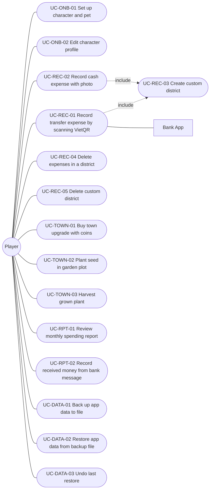

# PocketTown — Use Case Specifications

Companion to the [SRS](../SRS.md), section 4. Written with the 13-field Use Case template (Karl Wiegers / IIBA) and Alistair Cockburn's writing rules, following the *Use Case Writer* skill by Phúc NT (BA Zone · Digital School).

- Language: English (UI labels are quoted in Vietnamese exactly as they appear in the app, with an English gloss on first use).
- Screen codes such as **C2** or **D6** refer to frames in the [Figma prototype](https://www.figma.com/design/DzLoLblVhyGTE3Xntfhcvo).
- Business rules are referenced by ID (`RULE-xx`) from the [BRD](../BRD.md#8-quy-tắc-nghiệp-vụ); functional requirements by `FR-xx` from the [SRS](../SRS.md#3-yêu-cầu-chức-năng).

## Glossary

| Term | Meaning |
|---|---|
| Player | The owner of the iPhone who uses PocketTown. There is no account; one device = one player. |
| PocketTown | The system under discussion (the iOS app and its on-device database). |
| Bank App | A Vietnamese banking app installed on the same iPhone (secondary actor). |
| Expense | One spending record (amount, district, source, note, optional photo). |
| District | A spending category shown as a building in the town (Ăn uống, Mua sắm, …). |
| Custom district | A district the player creates on one of the 4 empty lots. |
| Coins (xu) | In-app reward points. Not money. Balance = sum of the coin ledger. |
| Autofill bank | A bank whose app accepts recipient, amount and note through a VietQR deeplink (marked ⚡). |
| Received money | Money coming in, read from a bank SMS. Not an expense, earns no coins. |

## Use Case List

| UC ID | UC Name | Primary Actor | Goal | Priority |
|---|---|---|---|---|
| [UC-ONB-01](#uc-onb-01-set-up-character-and-pet) | Set up character and pet | Player | Start playing with an own character and pet | Must |
| [UC-ONB-02](#uc-onb-02-edit-character-profile) | Edit character profile | Player | Change character, pet or names | Could |
| [UC-REC-01](#uc-rec-01-record-transfer-expense-by-scanning-vietqr) | Record transfer expense by scanning VietQR | Player | Log a QR transfer and open the bank app prefilled | Must |
| [UC-REC-02](#uc-rec-02-record-cash-expense-with-photo) | Record cash expense with photo | Player | Log a cash expense in seconds | Must |
| [UC-REC-03](#uc-rec-03-create-custom-district) | Create custom district | Player | Add an own spending category to the town | Should |
| [UC-REC-04](#uc-rec-04-delete-expenses-in-a-district) | Delete expenses in a district | Player | Remove wrong expenses and their coins | Must |
| [UC-REC-05](#uc-rec-05-delete-custom-district) | Delete custom district | Player | Free a lot taken by an unused district | Could |
| [UC-TOWN-01](#uc-town-01-buy-town-upgrade-with-coins) | Buy town upgrade with coins | Player | Raise a building level or buy a vehicle | Must |
| [UC-TOWN-02](#uc-town-02-plant-seed-in-garden-plot) | Plant seed in garden plot | Player | Grow a plant on an empty plot | Should |
| [UC-TOWN-03](#uc-town-03-harvest-grown-plant) | Harvest grown plant | Player | Free a plot after the plant has grown | Could |
| [UC-RPT-01](#uc-rpt-01-review-monthly-spending-report) | Review monthly spending report | Player | Understand where the month's money went | Must |
| [UC-RPT-02](#uc-rpt-02-record-received-money-from-bank-message) | Record received money from bank message | Player | Keep a list of money received | Should |
| [UC-DATA-01](#uc-data-01-back-up-app-data-to-file) | Back up app data to file | Player | Keep a copy of the data outside the phone | Should |
| [UC-DATA-02](#uc-data-02-restore-app-data-from-backup-file) | Restore app data from backup file | Player | Bring data onto a new or reset phone | Should |
| [UC-DATA-03](#uc-data-03-undo-last-restore) | Undo last restore | Player | Return to the data that existed before a restore | Could |

---

## UC-ONB-01: Set up character and pet

| **Use Case ID:** | UC-ONB-01 |
| ---: | :--- |
| **Use Case Name:** | Set up character and pet |
| **Created By:** | Nhím - Business Analyst | **Last Updated By:** | Nhím - Business Analyst |
| **Date Created:** | 2026-11-10 | **Date Last Updated:** | 2026-11-10 |

| **Actor:** | **Primary:** Player (first launch of PocketTown on this iPhone). **Secondary:** none. |
| ---: | :--- |
| **Description:** | When the player opens PocketTown for the first time, the player chooses a character, a pet and optional names so the town feels personal. The UC ends when the choice is saved on the device and the player is standing in the town. |
| **Preconditions:** | 1. PocketTown is installed and launched. 2. No saved player choice exists on the device. |
| **Postconditions:** | 1. The player choice (character, pet, character name, pet name) is saved in on-device settings. 2. The town screen (A2) is shown with the chosen character walking and the pet waiting in the pet yard. 3. Later launches open the town directly. |
| **Priority:** | Must — every other UC starts from the town, which needs a character. |
| **Frequency of Use:** | Once per install (plus once after a full data reset). |
| **Normal Course of Events:** | 1. Player launches PocketTown. 2. System displays the **Chào mừng tới PocketTown!** ("Welcome to PocketTown!") screen with 4 characters, 2 pets and two name fields (A1). 3. Player selects a character and a pet. 4. Player enters a character name and a pet name. 5. Player taps **Vào thị trấn** ("Enter town"). 6. System saves the player choice. 7. System displays the town with the chosen character and pet (A2). |
| **Alternative Courses:** | **UC-ONB-01.AC.1: Skip naming** At step 4 of the Normal Course, if the player leaves both name fields empty: 4a. System keeps the default labels (e.g. "Bạn nữ", "Cún con") as display names. → continue from step 5 of the Normal Course. |
| **Exceptions:** | **UC-ONB-01.EX.1: Name too long** Trigger: At step 4, the player types beyond 16 characters. Response: System stops accepting input at 16 characters and the counter shows "16/16". Final state: Player continues with the 16-character name; nothing saved yet.  **UC-ONB-01.EX.2: Settings cannot be saved** Trigger: At step 6, the on-device store fails to write. Response: System stays on A1 and shows an error asking the player to try again. Final state: No choice saved; the next launch shows A1 again. |
| **Includes:** | None. |
| **Special Requirements:** | **Performance**: A1 appears within 3 seconds of a cold start. **Usability**: Completable in 3 taps when names are skipped; all touch targets ≥ 44×44 pt. **Privacy**: Names are stored only on the device. |
| **Assumptions:** | 1. The player can read Vietnamese. |
| **Notes and Issues:** | [NOTE] The same screen in edit mode is UC-ONB-02. |

---

## UC-ONB-02: Edit character profile

| **Use Case ID:** | UC-ONB-02 |
| ---: | :--- |
| **Use Case Name:** | Edit character profile |
| **Created By:** | Nhím - Business Analyst | **Last Updated By:** | Nhím - Business Analyst |
| **Date Created:** | 2026-11-10 | **Date Last Updated:** | 2026-11-10 |

| **Actor:** | **Primary:** Player. **Secondary:** none. |
| ---: | :--- |
| **Description:** | When the player wants a different look or new names, the player opens the profile editor from the town or from Settings and saves the change. The UC ends when the town shows the new character and pet. |
| **Preconditions:** | 1. A player choice is already saved (UC-ONB-01 completed). |
| **Postconditions:** | 1. The saved player choice holds the new character, pet and names. 2. The town and Settings show the new values. |
| **Priority:** | Could — cosmetic; no data depends on it. |
| **Frequency of Use:** | Estimated 1–2 times per month per player. TBD — awaiting usage data [TBD-1]. |
| **Normal Course of Events:** | 1. Player taps the character chip at the top left of the town, or the **Tên, nhân vật và thú cưng** ("Name, character and pet") row in Settings. 2. System displays the profile editor with the current choice selected (A7). 3. Player changes the character, the pet or the names. 4. Player taps **Lưu** ("Save"). 5. System saves the new player choice. 6. System returns to the previous screen showing the new character and pet. |
| **Alternative Courses:** | **UC-ONB-02.AC.1: Cancel editing** At step 3 of the Normal Course, if the player taps **Huỷ** ("Cancel"): 3a. System discards the changes. → the UC ends with the previous choice unchanged. |
| **Exceptions:** | **UC-ONB-02.EX.1: Settings cannot be saved** Trigger: At step 5, the on-device store fails to write. Response: System keeps A7 open and shows an error asking the player to try again. Final state: The previous choice remains saved. |
| **Includes:** | None. |
| **Special Requirements:** | **Performance**: The town shows the new character within 1 second of saving. |
| **Assumptions:** | None. |
| **Notes and Issues:** | [TBD-1] Measure how often players change the profile. \| Owner: Nhím \| Due: after TestFlight \| Resolution: TBD. |

---

## UC-REC-01: Record transfer expense by scanning VietQR

| **Use Case ID:** | UC-REC-01 |
| ---: | :--- |
| **Use Case Name:** | Record transfer expense by scanning VietQR |
| **Created By:** | Nhím - Business Analyst | **Last Updated By:** | Nhím - Business Analyst |
| **Date Created:** | 2026-11-10 | **Date Last Updated:** | 2026-11-10 |

| **Actor:** | **Primary:** Player (about to pay a shop or a person by bank transfer). **Secondary:** Bank App, iOS Camera. |
| ---: | :--- |
| **Description:** | When the player is about to pay by bank transfer, the player scans the payee's VietQR code in PocketTown instead of in the bank app, so the expense is logged without typing the amount twice. The UC ends when the expense and its coins are saved and the chosen bank app is open with the transfer filled in (or with a ready-made QR for banks without autofill). |
| **Preconditions:** | 1. UC-ONB-01 is completed. 2. PocketTown has camera permission, or the player has a photo of the QR code in the photo library. 3. The bank app the player will pay with is installed on the iPhone. |
| **Postconditions:** | 1. One expense is saved with status 'completed', origin 'qr', the amount, district, bank, note and the payee's name, account and bank. 2. One `recordReward` coin entry for that expense is saved (RULE-01). 3. The Bank App is open, prefilled with payee, amount and note (autofill bank), or the bank's QR image is saved to Photos (other banks). 4. On returning, the town shows "Đã ghi khoản chi, +N xu" and the character walks to the district. |
| **Priority:** | Must — core recording path; ~60% of the persona's payments are QR transfers. |
| **Frequency of Use:** | Estimated 2–3 per player per day; peak around lunch (11:00–13:00). TBD — confirm after TestFlight [TBD-1]. |
| **Normal Course of Events:** | 1. Player taps the **Quét QR** ("Scan QR") button in the bottom bar. 2. System displays the camera with a scan frame and the hint "Đưa mã QR chuyển khoản vào khung" (C1). 3. Player points the camera at the payee's VietQR code. 4. System reads the code and displays the **Chuyển khoản** ("Transfer") screen with payee, amount, note, districts and banks (C2). 5. Player selects a district. 6. Player selects the bank to pay with. 7. System shows that the bank fills in the transfer by itself (⚡ hint). 8. Player taps **Mở app {bank}** ("Open {bank} app"). 9. System saves the expense and its coins (RULE-01, RULE-05). 10. System displays "Đang mở {bank}…" and opens the Bank App with the transfer prefilled (C4). 11. Player confirms the transfer inside the Bank App and returns to PocketTown. 12. System displays the town with "Đã ghi khoản chi, +N xu" and the character walks to the district (A3). |
| **Alternative Courses:** | **UC-REC-01.AC.1: Read the QR from a photo** At step 3 of the Normal Course, if the player taps **Chọn ảnh** ("Choose photo"): 3a. System opens the photo library. 3b. Player picks a photo that contains the QR code. → continue from step 4.  **UC-REC-01.AC.2: QR code has no amount** At step 4, if the code carries no amount: 4a. System shows "Bấm để nhập số tiền" ("Tap to enter amount") and disables the open-bank button. 4b. Player taps the amount and types it on the number pad (C5), then taps **Xong** ("Done"). → continue from step 5.  **UC-REC-01.AC.3: Bank without autofill** At step 7, if the selected bank is not an autofill bank: 7a. System shows a new QR code with the amount, under "Mã QR mang sang {bank}" (C3). 7b. Player taps **Mở app {bank}**. 7c. System saves the expense and its coins, saves the QR image to Photos and opens the Bank App. 7d. Player scans the newest photo inside the Bank App, confirms, and returns. 7e. System displays the town with a card listing account, amount and note, each with **Chép** ("Copy") (A6). → the UC ends.  **UC-REC-01.AC.4: Add a new district while recording** At step 5, if the player taps **+ Thêm khu** ("+ Add district"): 5a. System invokes UC-REC-03. 5b. System selects the new district. → continue from step 6. |
| **Exceptions:** | **UC-REC-01.EX.1: No camera permission** Trigger: At step 2, iOS denies camera access. Response: System shows "PocketTown cần camera để quét mã QR chuyển khoản.", **Cho phép dùng camera** ("Allow camera") and the photo option (C1b). Final state: Nothing saved; the player can allow the camera or continue with AC.1.  **UC-REC-01.EX.2: Not a VietQR transfer code** Trigger: At step 4, the code is not a VietQR transfer code, is damaged, or is not in VND. Response: System shows the matching message ("Mã QR này không phải mã chuyển khoản VietQR.", "Mã QR bị lỗi hoặc chụp chưa rõ, hãy quét lại." or "Mã QR không dùng tiền đồng (VND).") and keeps scanning. Final state: Nothing saved; the player stays on C1.  **UC-REC-01.EX.3: No QR in the chosen photo** Trigger: At step 3b (AC.1), the photo has no readable QR. Response: "Không thấy mã QR trong ảnh này. Hãy chọn ảnh chụp rõ cả mã." Final state: Nothing saved; the player can pick another photo.  **UC-REC-01.EX.4: Bank App cannot be opened** Trigger: At step 10, iOS cannot open the Bank App (not installed). Response: "Không mở được app {bank}. Bạn đã cài app này chưa?" on the transfer screen (C6), with all inputs kept. Final state: No expense and no coins saved; the player can pick another bank.  **UC-REC-01.EX.5: Expense cannot be saved** Trigger: At step 9, the database write fails. Response: "Không lưu được khoản chi. Bạn thử lại nhé." Final state: No expense, no coins, Bank App not opened; inputs kept. |
| **Includes:** | UC-REC-03: Create custom district (invoked at step 5a of AC.4) |
| **Special Requirements:** | **Performance**: A code is read within 1 second of being in frame; saving takes ≤ 300 ms. **Usability**: After scanning, ≤ 3 taps to open the bank (district, bank, open). **Security / Privacy**: PocketTown never stores the player's own account numbers or passwords and never moves money; payee data stays on the device. **Reliability**: The expense and its coin entry are written in one transaction. |
| **Assumptions:** | 1. The player completes the transfer in the Bank App (RULE-05: no "did you pay?" check). 2. Autofill banks keep accepting the VietQR deeplink format. |
| **Notes and Issues:** | [TBD-1] Real frequency of QR payments per day. \| Owner: Nhím \| Due: after TestFlight \| Resolution: TBD. [NOTE] A player who does not finish the transfer deletes the expense with UC-REC-04. |

---

## UC-REC-02: Record cash expense with photo

| **Use Case ID:** | UC-REC-02 |
| ---: | :--- |
| **Use Case Name:** | Record cash expense with photo |
| **Created By:** | Nhím - Business Analyst | **Last Updated By:** | Nhím - Business Analyst |
| **Date Created:** | 2026-11-10 | **Date Last Updated:** | 2026-11-10 |

| **Actor:** | **Primary:** Player (has just paid in cash). **Secondary:** iOS Camera. |
| ---: | :--- |
| **Description:** | Right after paying in cash, the player takes a photo of what was bought, types the amount over the photo and picks a district, so cash spending is not forgotten. The UC ends when the expense, its photo and its coins are saved and the town shows the reward. |
| **Preconditions:** | 1. UC-ONB-01 is completed. 2. PocketTown has camera permission. |
| **Postconditions:** | 1. One expense is saved with origin 'photo', the amount, district, note and photo file name. 2. The photo is stored in the app's folder on the device, longest side ≤ 1080 px. 3. A `recordReward` entry is saved, plus a `photoBonus` +10 entry when today's photo bonus is under 50 coins (RULE-01, RULE-02). 4. The town shows "Đã ghi khoản chi, +N xu" and the character walks to the district. |
| **Priority:** | Must — the only quick path for cash, ~40% of the persona's payments. |
| **Frequency of Use:** | Estimated 1–2 per player per day. TBD — confirm after TestFlight [TBD-1]. |
| **Normal Course of Events:** | 1. Player taps **Chụp ảnh** ("Photo") in the bottom bar. 2. System displays the camera screen "Chụp khoản chi" (B1). 3. Player taps the shutter button. 4. System displays the **Khoản chi có ảnh** ("Expense with photo") form with the square photo (B3). 5. Player taps the amount on the photo. 6. System displays the number pad sheet "Số tiền đã chi" (B4). 7. Player types the amount and taps **Xong** ("Done"). 8. Player selects a district and types an optional note. 9. Player taps **Lưu** ("Save"). 10. System validates the amount (FR-49), saves the expense, the photo and the coins. 11. System displays the town with "Đã ghi khoản chi, +N xu" (A3). |
| **Alternative Courses:** | **UC-REC-02.AC.1: Record without a photo** At step 3 of the Normal Course, if the player taps **Bỏ qua ảnh** ("Skip photo"): 3a. System displays the **Khoản chi** form without a photo (B6). → continue from step 5; no photo bonus is given.  **UC-REC-02.AC.2: Retake the photo** At step 5, if the player taps **Chụp lại** ("Retake"): 5a. System returns to the camera (B1). → continue from step 3.  **UC-REC-02.AC.3: Add a new district** At step 8, if the player taps **+ Thêm khu**: 8a. System invokes UC-REC-03 and selects the new district. → continue from step 9. |
| **Exceptions:** | **UC-REC-02.EX.1: No camera permission** Trigger: At step 2, iOS denies camera access. Response: Message that PocketTown needs the camera, with **Cho phép dùng camera** and **Bỏ qua ảnh** (B2). Final state: Nothing saved; the player can allow the camera or continue with AC.1.  **UC-REC-02.EX.2: Photo cannot be taken** Trigger: At step 3, the camera fails to capture. Response: "Không chụp được ảnh. Bạn thử lại nhé." Final state: Nothing saved; camera stays open.  **UC-REC-02.EX.3: Invalid amount** Trigger: At step 10, the amount is 0 or above 999,999,999đ. Response: The **Lưu** button stays disabled until the amount is valid. Final state: Nothing saved; form kept.  **UC-REC-02.EX.4: Expense cannot be saved** Trigger: At step 10, the database or file write fails. Response: "Không lưu được khoản chi. Bạn thử lại nhé." Final state: No expense, no photo file, no coins; form kept.  **UC-REC-02.EX.5: Daily photo bonus reached** Trigger: At step 10, today's photo bonuses already total 50 coins. Response: The expense and photo are saved; the reward shows only the record coins. Final state: Expense saved without `photoBonus` (RULE-02). |
| **Includes:** | UC-REC-03: Create custom district (invoked at step 8a of AC.3) |
| **Special Requirements:** | **Performance**: From shutter to the form ≤ 1 second; saving ≤ 300 ms. **Usability**: The whole flow takes ≤ 15 seconds for a practised player (BRD BO-2). **Privacy**: Photos never leave the device and are not in backups. **Reliability**: Expense, photo and coins are saved together or not at all. |
| **Assumptions:** | 1. Each photo is about 300 KB, so storage is not a constraint. |
| **Notes and Issues:** | [TBD-1] Real frequency of cash expenses. \| Owner: Nhím \| Due: after TestFlight \| Resolution: TBD. [TBD-2] Include photos in backups later? \| Owner: Nhím \| Due: phase 7 \| Resolution: deferred. |

---

## UC-REC-03: Create custom district

| **Use Case ID:** | UC-REC-03 |
| ---: | :--- |
| **Use Case Name:** | Create custom district |
| **Created By:** | Nhím - Business Analyst | **Last Updated By:** | Nhím - Business Analyst |
| **Date Created:** | 2026-11-10 | **Date Last Updated:** | 2026-11-10 |

| **Actor:** | **Primary:** Player. **Secondary:** none. |
| ---: | :--- |
| **Description:** | When none of the six standard districts fits an expense, the player creates an own district (e.g. "Cà phê") while recording. The UC ends when the district is saved, its building stands on the next empty lot and it is selectable for expenses. |
| **Preconditions:** | 1. The player is on an expense form (UC-REC-01 or UC-REC-02). |
| **Postconditions:** | 1. A custom district is saved with name, colour, building style and lot number. 2. The town shows the new building on that lot. 3. The district is selected on the expense form. |
| **Priority:** | Should — needed by players whose spending does not fit the six defaults. |
| **Frequency of Use:** | At most 4 times per install (4 lots). |
| **Normal Course of Events:** | 1. Player taps **+ Thêm khu** ("+ Add district") on the expense form. 2. System displays the **Khu chi tiêu mới** ("New district") sheet with lot count (B5). 3. Player types the district name. 4. Player selects a colour and a building style. 5. Player taps **Xây khu này** ("Build this district"). 6. System validates the name and saves the district on the next empty lot. 7. System closes the sheet and selects the new district on the expense form. |
| **Alternative Courses:** | **UC-REC-03.AC.1: Close without creating** At step 3 of the Normal Course, if the player taps outside the sheet: 3a. System closes the sheet. → the UC ends; the form is unchanged. |
| **Exceptions:** | **UC-REC-03.EX.1: All lots are taken** Trigger: At step 2, all 4 lots hold custom districts (RULE-12). Response: "Thị trấn đã kín 4 lô đất trống…" with **Đã hiểu** ("Got it"). Final state: No district created.  **UC-REC-03.EX.2: Name missing or too long** Trigger: At step 6, the name is empty or longer than 16 characters. Response: **Xây khu này** stays disabled; the counter shows the limit. Final state: Nothing saved.  **UC-REC-03.EX.3: District cannot be saved** Trigger: At step 6, the database write fails. Response: "Không lưu được khu mới. Bạn thử lại nhé." Final state: Nothing saved; sheet kept open. |
| **Includes:** | None. |
| **Special Requirements:** | **Performance**: The building appears in the town within 1 second. **Usability**: 11 colours and 5 building styles, each with a preview. |
| **Assumptions:** | None. |
| **Notes and Issues:** | [NOTE] Upgrades for custom districts show "Sắp có" ("Coming soon") until assets exist. |

---

## UC-REC-04: Delete expenses in a district

| **Use Case ID:** | UC-REC-04 |
| ---: | :--- |
| **Use Case Name:** | Delete expenses in a district |
| **Created By:** | Nhím - Business Analyst | **Last Updated By:** | Nhím - Business Analyst |
| **Date Created:** | 2026-11-10 |  **Date Last Updated:** | 2026-11-10 |

| **Actor:** | **Primary:** Player. **Secondary:** none. |
| ---: | :--- |
| **Description:** | When an expense was logged by mistake (for example a QR transfer the player never sent), the player removes it from its district. The UC ends when the expenses, their photos and the coins they earned are removed and the totals are updated. |
| **Preconditions:** | 1. The district has at least one expense in the viewed month. |
| **Postconditions:** | 1. The selected expenses and their photo files are deleted. 2. One `rewardReversal` entry per expense removes all coins it earned; the balance never goes below 0 (RULE-04). 3. District totals, the report and the Đầu tư calendar no longer include them. |
| **Priority:** | Must — without it a wrong expense would distort totals and coins forever. |
| **Frequency of Use:** | Estimated 2–4 per player per month. |
| **Normal Course of Events:** | 1. Player taps a district building in the town. 2. System displays the district's **Chi tiêu** ("Spending") tab with the month's expenses (D1). 3. Player taps **Chọn** ("Select"). 4. System shows a checkbox on each expense and "Chạm vào khoản muốn xoá" (D3). 5. Player taps the expenses to delete. 6. System shows "Đã chọn N khoản" and **Xoá (N)** ("Delete (N)"). 7. Player taps **Xoá (N)**. 8. System asks "Xoá khoản này?" with the total amount and "Bạn sẽ bị trừ N xu." (D4). 9. Player taps **Xoá**. 10. System deletes the expenses, their photos and coins, and refreshes the list. |
| **Alternative Courses:** | **UC-REC-04.AC.1: Delete from the report** At step 1 of the Normal Course, if the player opens the expense in **Báo cáo** ("Report"): 1a. System displays the expense detail sheet (E3). 1b. Player taps **Xoá khoản này** ("Delete this expense"). → continue from step 8 with one expense. |
| **Exceptions:** | **UC-REC-04.EX.1: Player cancels** Trigger: At step 9, the player taps **Huỷ** ("Cancel"). Response: System closes the dialog and keeps the selection. Final state: Nothing deleted.  **UC-REC-04.EX.2: Not enough coins to reverse** Trigger: At step 10, the balance is smaller than the coins to remove. Response: The dialog at step 8 already shows the real amount that will be deducted. Final state: Expenses deleted; balance set to 0; the waived shortfall is stored on the entry.  **UC-REC-04.EX.3: Delete fails** Trigger: At step 10, the database write fails. Response: Error message; list unchanged. Final state: No expense, photo or coin change (single transaction). |
| **Includes:** | None. |
| **Special Requirements:** | **Reliability**: Expenses and coin reversals are removed in one transaction. **Usability**: The coin loss is shown before confirming. |
| **Assumptions:** | None. |
| **Notes and Issues:** | [NOTE] Editing an expense amount (RULE-03) is a separate future UC. |

---

## UC-REC-05: Delete custom district

| **Use Case ID:** | UC-REC-05 |
| ---: | :--- |
| **Use Case Name:** | Delete custom district |
| **Created By:** | Nhím - Business Analyst | **Last Updated By:** | Nhím - Business Analyst |
| **Date Created:** | 2026-11-10 | **Date Last Updated:** | 2026-11-10 |

| **Actor:** | **Primary:** Player. **Secondary:** none. |
| ---: | :--- |
| **Description:** | When a custom district is no longer useful, the player removes it to free the lot for another one. The UC ends when the building is gone and the lot is empty, while past expenses stay in the report. |
| **Preconditions:** | 1. At least one custom district exists. |
| **Postconditions:** | 1. The custom district record is deleted and its lot is empty. 2. Expenses filed under it are kept and still appear in the report. |
| **Priority:** | Could — frees one of only 4 lots. |
| **Frequency of Use:** | Rare; estimated under once per month. |
| **Normal Course of Events:** | 1. Player taps the custom district building in the town. 2. System displays the district screen. 3. Player opens the **Nâng cấp** ("Upgrade") tab. 4. System shows the "Sắp có" card and the **Xoá khu này** ("Delete this district") card (D11). 5. Player taps **Xoá khu** ("Delete district"). 6. System asks "Xoá khu "{name}"?" (D12). 7. Player taps **Xoá**. 8. System deletes the district and shows "Đã xoá khu, lô đất trống lại rồi" in the town. |
| **Alternative Courses:** | None. |
| **Exceptions:** | **UC-REC-05.EX.1: Player cancels** Trigger: At step 7, the player taps **Huỷ**. Response: Dialog closes. Final state: District kept.  **UC-REC-05.EX.2: Delete fails** Trigger: At step 8, the database write fails. Response: Error message. Final state: District kept. |
| **Includes:** | None. |
| **Special Requirements:** | **Reliability**: Deleting a district never deletes expenses. |
| **Assumptions:** | None. |
| **Notes and Issues:** | [TBD-1] Show old expenses of a deleted district under its name or as "Khác"? \| Owner: Nhím \| Due: 2026-11-30 \| Resolution: TBD. |

---

## UC-TOWN-01: Buy town upgrade with coins

| **Use Case ID:** | UC-TOWN-01 |
| ---: | :--- |
| **Use Case Name:** | Buy town upgrade with coins |
| **Created By:** | Nhím - Business Analyst | **Last Updated By:** | Nhím - Business Analyst |
| **Date Created:** | 2026-11-10 | **Date Last Updated:** | 2026-11-10 |

| **Actor:** | **Primary:** Player. **Secondary:** none. |
| ---: | :--- |
| **Description:** | When the player has saved enough coins, the player spends them on the next level of a building or the next vehicle, which is the reward loop that keeps the recording habit alive. The UC ends when the coins are deducted, the new level is owned and the town shows the new model. |
| **Preconditions:** | 1. The chosen track (a district building, home, pet yard, seed shop or vehicle) is below its last level for sale. |
| **Postconditions:** | 1. A `purchase` entry deducts the price from the balance. 2. The track's owned level is increased by 1. 3. The town shows the new building model, or the new vehicle in the garage, which the character now rides. |
| **Priority:** | Must — the main reason to earn coins. |
| **Frequency of Use:** | Estimated 1–3 per player per week early on, fewer later as prices grow. |
| **Normal Course of Events:** | 1. Player taps a building in the town. 2. System displays the place screen. 3. Player opens the **Nâng cấp** ("Upgrade") tab. 4. System displays "Bạn có N xu" and the level cards, with **Mua với N xu** ("Buy for N coins") on the next level (D6). 5. Player taps **Mua với N xu**. 6. System validates the purchase (RULE-06, RULE-07). 7. System deducts the coins and saves the new level. 8. System shows "Đã lên cấp N: {name}. Bạn trả N xu." and updates the model (D7). |
| **Alternative Courses:** | **UC-TOWN-01.AC.1: Buy a vehicle from the empty garage** At step 3 of the Normal Course, if the place is the garage and it is empty: 3a. System displays "Gara còn trống" ("Garage is empty") with **Mua xe đầu tiên** ("Buy first vehicle") (D8). 3b. Player taps **Mua xe đầu tiên**. 3c. System displays the vehicle list starting at Xe đạp 40 xu (D9). → continue from step 5; at step 8 the message is "{vehicle} đã về gara" (D9b). |
| **Exceptions:** | **UC-TOWN-01.EX.1: Not enough coins** Trigger: At step 4, the balance is below the price. Response: The button is disabled with "Còn thiếu N xu. Ghi thêm chi tiêu để nhận xu." Final state: Nothing bought.  **UC-TOWN-01.EX.2: Previous level not owned** Trigger: At step 4, for levels beyond the next one. Response: Card shows "N xu, mở sau cấp N-1." with a lock. Final state: Nothing bought.  **UC-TOWN-01.EX.3: Purchase cannot be saved** Trigger: At step 7, the database write fails. Response: Error message; level cards unchanged. Final state: No coins deducted, level unchanged (single transaction).  **UC-TOWN-01.EX.4: Model fails to load** Trigger: At step 8, the new 3D model cannot be loaded. Response: The lot shows its base without a building; the purchase stands. Final state: Level and coins saved; error logged. |
| **Includes:** | None. |
| **Special Requirements:** | **Reliability**: Coin deduction and level change are one transaction; buying the same level twice is rejected, not charged. **Performance**: The new model appears within 1 second. **Integrity**: Only the purchase service writes coin entries; the 3D layer never does. |
| **Assumptions:** | 1. 3D assets exist for levels 1–7 of each building and 4 vehicles. |
| **Notes and Issues:** | [TBD-1] Levels 8–10 and pet clothes. \| Owner: Nhím \| Due: phase 7 \| Resolution: deferred. |

---

## UC-TOWN-02: Plant seed in garden plot

| **Use Case ID:** | UC-TOWN-02 |
| ---: | :--- |
| **Use Case Name:** | Plant seed in garden plot |
| **Created By:** | Nhím - Business Analyst | **Last Updated By:** | Nhím - Business Analyst |
| **Date Created:** | 2026-11-10 | **Date Last Updated:** | 2026-11-10 |

| **Actor:** | **Primary:** Player. **Secondary:** none. |
| ---: | :--- |
| **Description:** | To use small amounts of coins and have a reason to come back later, the player buys a seed and plants it on an empty garden plot. The UC ends when the coins are deducted and the seedling is growing on that plot. |
| **Preconditions:** | 1. At least one of the 6 garden plots is empty. |
| **Postconditions:** | 1. A `purchase` entry deducts the seed price (RULE-08). 2. The plot is saved with the seed and the planting time. 3. The town shows the seedling, which grows over the seed's growing time. |
| **Priority:** | Should — gives a cheap, frequent coin sink. |
| **Frequency of Use:** | Estimated 3–6 per player per week. |
| **Normal Course of Events:** | 1. Player taps an empty plot in the garden. 2. System displays the card "Ô đất số N" with the coin balance and 4 seeds with price and growing time (A4). 3. Player taps a seed. 4. System validates the balance. 5. System deducts the price and saves the plot. 6. System closes the card and shows the seedling on the plot. |
| **Alternative Courses:** | **UC-TOWN-02.AC.1: Close without planting** At step 3 of the Normal Course, if the player taps ✕: 3a. System closes the card. → the UC ends; nothing changes. |
| **Exceptions:** | **UC-TOWN-02.EX.1: Not enough coins** Trigger: At step 4, the balance is below the seed price. Response: The seed tile is disabled. Final state: Nothing bought.  **UC-TOWN-02.EX.2: Planting cannot be saved** Trigger: At step 5, the database write fails. Response: Error message; card kept. Final state: No coins deducted; plot empty. |
| **Includes:** | None. |
| **Special Requirements:** | **Reliability**: Coin deduction and plot row are one transaction. **Usability**: Each seed shows price and growing time before buying. |
| **Assumptions:** | 1. Growth is computed from the device clock. |
| **Notes and Issues:** | [TBD-1] Harvest reward (coins or items)? \| Owner: Nhím \| Due: phase 7 \| Resolution: TBD. |

---

## UC-TOWN-03: Harvest grown plant

| **Use Case ID:** | UC-TOWN-03 |
| ---: | :--- |
| **Use Case Name:** | Harvest grown plant |
| **Created By:** | Nhím - Business Analyst | **Last Updated By:** | Nhím - Business Analyst |
| **Date Created:** | 2026-11-10 | **Date Last Updated:** | 2026-11-10 |

| **Actor:** | **Primary:** Player. **Secondary:** none. |
| ---: | :--- |
| **Description:** | When a plant has finished growing, the player harvests it to empty the plot for a new seed. The UC ends when the plot is empty again. |
| **Preconditions:** | 1. A plot holds a plant whose growing time has fully passed. |
| **Postconditions:** | 1. The plot record is removed and the plot is empty. 2. The town no longer shows the plant. |
| **Priority:** | Could — the garden is decoration in the MVP. |
| **Frequency of Use:** | Same as UC-TOWN-02. |
| **Normal Course of Events:** | 1. Player taps a plot with a grown plant. 2. System displays the plot card with the progress bar at 100% and **Thu hoạch** ("Harvest") (A5). 3. Player taps **Thu hoạch**. 4. System empties the plot. 5. System shows "Thu hoạch xong, ô đất đã trống để trồng tiếp". |
| **Alternative Courses:** | **UC-TOWN-03.AC.1: Plant is still growing** At step 2 of the Normal Course, if the plant has not finished growing: 2a. System shows the stage and progress bar without **Thu hoạch**. → the UC ends. |
| **Exceptions:** | **UC-TOWN-03.EX.1: Harvest cannot be saved** Trigger: At step 4, the database write fails. Response: Error message. Final state: The plant stays on the plot. |
| **Includes:** | None. |
| **Special Requirements:** | **Performance**: The plant disappears within 1 second. |
| **Assumptions:** | None. |
| **Notes and Issues:** | [NOTE] Harvest earns nothing yet; see UC-TOWN-02 [TBD-1]. |

---

## UC-RPT-01: Review monthly spending report

| **Use Case ID:** | UC-RPT-01 |
| ---: | :--- |
| **Use Case Name:** | Review monthly spending report |
| **Created By:** | Nhím - Business Analyst | **Last Updated By:** | Nhím - Business Analyst |
| **Date Created:** | 2026-11-10 | **Date Last Updated:** | 2026-11-10 |

| **Actor:** | **Primary:** Player. **Secondary:** none. |
| ---: | :--- |
| **Description:** | To understand where the month's money went, the player opens the report, reads the totals, the split by district and the Đầu tư calendar, and drills into a district or a day. The UC ends when the player has seen the expenses behind the number they care about. |
| **Preconditions:** | 1. UC-ONB-01 is completed. |
| **Postconditions:** | 1. No data is changed (read-only UC). 2. The report shows totals for the selected month and, when filtered, only the matching expenses. |
| **Priority:** | Must — the "insight" half of the product (BRD BO-4). |
| **Frequency of Use:** | Estimated 2–3 per player per week; peak at month end. |
| **Normal Course of Events:** | 1. Player taps **Báo cáo** ("Report") in the bottom bar. 2. System displays the current month: total spent, projected month total, average per day, highest day and days with spending (E1). 3. System displays the split by district and the Đầu tư calendar with 4 shading levels (RULE-10). 4. Player taps a district in **Chi cho gì** ("Spent on what"). 5. System lists that district's expenses for the month with **Bỏ lọc** ("Clear filter") (E2). 6. Player taps an expense. 7. System displays its detail sheet: photo, district, amount, time, source, recording method, payee and note (E3). 8. Player taps **Xong** ("Done"). |
| **Alternative Courses:** | **UC-RPT-01.AC.1: Filter by day** At step 4 of the Normal Course, if the player taps a day in the calendar: 4a. System lists that day's expenses (E2b). → continue from step 6.  **UC-RPT-01.AC.2: View another month** At step 2, if the player taps **Trước** ("Previous"): 2a. System displays the previous month. → continue from step 3. **Sau** ("Next") is disabled on the current month. |
| **Exceptions:** | **UC-RPT-01.EX.1: No expenses this month** Trigger: At step 2, the month has no expenses. Response: Totals show 0đ, the calendar is blank and the list is empty. Final state: Nothing changed.  **UC-RPT-01.EX.2: Data cannot be read** Trigger: At step 2, the database read fails. Response: "Không đọc được các khoản chi trên máy." Final state: Nothing changed. |
| **Includes:** | None. |
| **Special Requirements:** | **Performance**: The report for a month with 300 expenses renders within 1 second. **Accuracy**: Money is summed as whole đồng integers; received money is excluded (RULE-09). |
| **Assumptions:** | 1. Week starts on Monday, using the device time zone. |
| **Notes and Issues:** | [NOTE] Deleting from the detail sheet is UC-REC-04.AC.1. |

---

## UC-RPT-02: Record received money from bank message

| **Use Case ID:** | UC-RPT-02 |
| ---: | :--- |
| **Use Case Name:** | Record received money from bank message |
| **Created By:** | Nhím - Business Analyst | **Last Updated By:** | Nhím - Business Analyst |
| **Date Created:** | 2026-11-10 | **Date Last Updated:** | 2026-11-10 |

| **Actor:** | **Primary:** Player. **Secondary:** iOS Clipboard, iOS Shortcuts. |
| ---: | :--- |
| **Description:** | When money arrives (allowance, salary, a friend paying back), the player pastes the bank's balance-change message into the report so PocketTown can list it, without counting it as spending. The UC ends when the received amount is saved under **Tiền nhận vào** ("Money received"). |
| **Preconditions:** | 1. The player has copied a bank SMS that reports an incoming amount. |
| **Postconditions:** | 1. One received-money record is saved with amount, bank, note, time and the raw message. 2. No expense and no coins are created (RULE-09). |
| **Priority:** | Should — gives a fuller picture of the month. |
| **Frequency of Use:** | Estimated 2–6 per player per month. |
| **Normal Course of Events:** | 1. Player opens **Báo cáo** and taps **Dán tin nhắn ngân hàng** ("Paste bank message"). 2. System reads the clipboard and parses amount, sender, note and time. 3. System displays the panel "PocketTown đọc được" ("PocketTown read") with those values and **Huỷ** / **Lưu** (E5). 4. Player taps **Lưu**. 5. System saves the record. 6. System shows "Đã lưu tiền nhận vào +{amount}" and the new row in the list (E5b). |
| **Alternative Courses:** | **UC-RPT-02.AC.1: Message arrives through iOS Shortcuts** At step 1 of the Normal Course, if an iOS Shortcut opens `pockettown://bank-message?text=…`: 1a. System takes the text from the link. → continue from step 2; the panel is skipped and the record is saved directly (step 5). |
| **Exceptions:** | **UC-RPT-02.EX.1: Outgoing message** Trigger: At step 2, the message reports money going out. Response: "Tin tiền ra không được lưu, chỉ lưu tiền nhận vào". Final state: Nothing saved.  **UC-RPT-02.EX.2: Amount not found or invalid** Trigger: At step 2, no amount is found or it is invalid. Response: "Không đọc được số tiền trong tin nhắn này" / "Số tiền trong tin nhắn không hợp lệ". Final state: Nothing saved.  **UC-RPT-02.EX.3: Duplicate message** Trigger: At step 5, the same text was saved within the last 10 minutes. Response: "Tin nhắn này vừa được lưu rồi". Final state: No second record.  **UC-RPT-02.EX.4: Record cannot be saved** Trigger: At step 5, the database write fails. Response: "Không lưu được tin nhắn ngân hàng". Final state: Nothing saved. |
| **Includes:** | None. |
| **Special Requirements:** | **Privacy**: The message is read only when the player taps paste or runs the Shortcut; it is stored only on the device. **Compliance**: iOS does not let apps read other apps' notifications; only SMS (Shortcut) or pasted text is supported. |
| **Assumptions:** | 1. The player's bank sends balance-change SMS in a format with a "+" amount. |
| **Notes and Issues:** | [TBD-1] Support banks that only send in-app notifications. \| Owner: Nhím \| Due: TBD \| Resolution: blocked by iOS. |

---

## UC-DATA-01: Back up app data to file

| **Use Case ID:** | UC-DATA-01 |
| ---: | :--- |
| **Use Case Name:** | Back up app data to file |
| **Created By:** | Nhím - Business Analyst | **Last Updated By:** | Nhím - Business Analyst |
| **Date Created:** | 2026-11-10 | **Date Last Updated:** | 2026-11-10 |

| **Actor:** | **Primary:** Player. **Secondary:** iOS Share Sheet (Files, AirDrop, Zalo, Mail). |
| ---: | :--- |
| **Description:** | Because PocketTown has no account or server, the player saves a backup file somewhere outside the app to protect against losing the phone. The UC ends when the backup file has been handed to the destination the player picked. |
| **Preconditions:** | 1. UC-ONB-01 is completed. |
| **Postconditions:** | 1. A file `PocketTown_SaoLuu_YYYY-MM-DD.json` exists at the chosen destination. 2. It contains expenses, coin ledger, custom districts, owned levels, garden, received money, player choice, settings and the data version; photos are not included. |
| **Priority:** | Should — the only protection against data loss. |
| **Frequency of Use:** | Estimated 1–2 per player per month. |
| **Normal Course of Events:** | 1. Player taps **Cài đặt** ("Settings") in the bottom bar. 2. System displays Settings (F1). 3. Player taps **Sao lưu dữ liệu** ("Back up data"). 4. System creates the backup file. 5. System opens the iOS share sheet with the file (F5). 6. Player chooses a destination (e.g. **Lưu vào Tệp**, "Save to Files"). 7. iOS saves or sends the file. |
| **Alternative Courses:** | **UC-DATA-01.AC.1: Player closes the share sheet** At step 6 of the Normal Course, if the player taps ✕: 6a. System closes the share sheet. → the UC ends without a saved copy. |
| **Exceptions:** | **UC-DATA-01.EX.1: File cannot be created** Trigger: At step 4, writing the file fails. Response: Alert "Chưa sao lưu được" — "Không tạo được file sao lưu. Bạn thử lại nhé." Final state: No file; data unchanged. |
| **Includes:** | None. |
| **Special Requirements:** | **Privacy**: The file goes only where the player sends it; PocketTown uploads nothing. **Performance**: File ready within 2 seconds for 5,000 expenses. |
| **Assumptions:** | 1. The player keeps the file somewhere reachable from the new phone. |
| **Notes and Issues:** | [TBD-1] Back up photos too. \| Owner: Nhím \| Due: phase 7 \| Resolution: deferred. |

---

## UC-DATA-02: Restore app data from backup file

| **Use Case ID:** | UC-DATA-02 |
| ---: | :--- |
| **Use Case Name:** | Restore app data from backup file |
| **Created By:** | Nhím - Business Analyst | **Last Updated By:** | Nhím - Business Analyst |
| **Date Created:** | 2026-11-10 | **Date Last Updated:** | 2026-11-10 |

| **Actor:** | **Primary:** Player. **Secondary:** iOS Files (document picker). |
| ---: | :--- |
| **Description:** | When moving to a new phone or after reinstalling, the player loads a backup file to get expenses, coins and the town back. The UC ends when the data on the phone is replaced by the backup, with a safety copy of the previous data kept for undo. |
| **Preconditions:** | 1. A backup file made by UC-DATA-01 is reachable in iOS Files. |
| **Postconditions:** | 1. All app data is replaced by the backup's data. 2. A safety copy of the previous data is kept (newest 5 copies). 3. Settings show **Hoàn tác lần khôi phục** ("Undo last restore") (F6). |
| **Priority:** | Should — makes the backup useful. |
| **Frequency of Use:** | Rare; about once per phone change. |
| **Normal Course of Events:** | 1. Player taps **Khôi phục từ file** ("Restore from file") in Settings. 2. System opens the iOS document picker. 3. Player picks the backup file. 4. System reads and checks the file. 5. System asks "Khôi phục dữ liệu?" with the backup date, number of expenses, coins, and a warning that current data will be replaced (F4). 6. Player taps **Khôi phục** ("Restore"). 7. System saves a safety copy of the current data. 8. System replaces the data and shows "Đã khôi phục dữ liệu" (F6). |
| **Alternative Courses:** | None. |
| **Exceptions:** | **UC-DATA-02.EX.1: Not a PocketTown backup** Trigger: At step 4, the file is not a PocketTown backup. Response: Alert "Không khôi phục được" — "File này không phải bản sao lưu của PocketTown." Final state: Data unchanged.  **UC-DATA-02.EX.2: Backup from a newer app version** Trigger: At step 4, the file's data version is newer than the app. Response: "Bản sao lưu này do phiên bản PocketTown mới hơn tạo ra. Hãy cập nhật app rồi thử lại." Final state: Data unchanged.  **UC-DATA-02.EX.3: Player cancels** Trigger: At step 6, the player taps **Huỷ**. Response: Dialog closes. Final state: Data unchanged.  **UC-DATA-02.EX.4: Restore fails midway** Trigger: At step 8, writing the data fails. Response: Alert "Không khôi phục được". Final state: Previous data kept (the replace runs in one transaction). |
| **Includes:** | None. |
| **Special Requirements:** | **Reliability**: Replace is all-or-nothing; a safety copy always exists before replacing. **Usability**: The confirmation states exactly what will be replaced. |
| **Assumptions:** | 1. Photos are not restored; they remain only on the old phone. |
| **Notes and Issues:** | [NOTE] UC-DATA-03 reverses this UC. |

---

## UC-DATA-03: Undo last restore

| **Use Case ID:** | UC-DATA-03 |
| ---: | :--- |
| **Use Case Name:** | Undo last restore |
| **Created By:** | Nhím - Business Analyst | **Last Updated By:** | Nhím - Business Analyst |
| **Date Created:** | 2026-11-10 | **Date Last Updated:** | 2026-11-10 |

| **Actor:** | **Primary:** Player. **Secondary:** none. |
| ---: | :--- |
| **Description:** | When a restore brought back the wrong data, the player returns to the data that existed just before that restore. The UC ends when the safety copy is back in place. |
| **Preconditions:** | 1. At least one safety copy from UC-DATA-02 exists on the device. |
| **Postconditions:** | 1. App data equals the newest safety copy. 2. Town, coins and report reflect that data. |
| **Priority:** | Could — protects against a mistaken restore. |
| **Frequency of Use:** | Rare. |
| **Normal Course of Events:** | 1. Player taps **Hoàn tác lần khôi phục** in Settings. 2. System asks for confirmation with the time of the safety copy. 3. Player taps **Hoàn tác** ("Undo"). 4. System replaces the data with the newest safety copy. 5. System shows Settings with the restored data. |
| **Alternative Courses:** | None. |
| **Exceptions:** | **UC-DATA-03.EX.1: No safety copy** Trigger: At step 4, no safety copy is found. Response: "Không có bản dự phòng nào trên máy." Final state: Data unchanged.  **UC-DATA-03.EX.2: Player cancels** Trigger: At step 3, the player taps **Huỷ**. Response: Dialog closes. Final state: Data unchanged. |
| **Includes:** | None. |
| **Special Requirements:** | **Reliability**: The replace is all-or-nothing. |
| **Assumptions:** | None. |
| **Notes and Issues:** | None. |

---

## Validation summary (20-point checklist)

Each UC above was checked against the 20 points (C1–C20) of the Use Case Writer skill.

| UC | Result | Follow-up |
|---|---|---|
| UC-ONB-01 | 20/20 ✅ | — |
| UC-ONB-02 | 19/20 ✅ + 1 ⚠️ | C8: frequency estimated, [TBD-1] |
| UC-REC-01 | 19/20 ✅ + 1 ⚠️ | C8: frequency estimated from persona, [TBD-1] |
| UC-REC-02 | 19/20 ✅ + 1 ⚠️ | C8: frequency estimated from persona, [TBD-1] |
| UC-REC-03 | 20/20 ✅ | — |
| UC-REC-04 | 19/20 ✅ + 1 ⚠️ | C8: frequency estimated |
| UC-REC-05 | 19/20 ✅ + 1 ⚠️ | C8: frequency estimated |
| UC-TOWN-01 | 19/20 ✅ + 1 ⚠️ | C8: frequency estimated |
| UC-TOWN-02 | 19/20 ✅ + 1 ⚠️ | C8: frequency estimated |
| UC-TOWN-03 | 18/20 ✅ + 2 ⚠️ | C8: frequency follows UC-TOWN-02; C18: only one exception, acceptable for a one-tap UC |
| UC-RPT-01 | 19/20 ✅ + 1 ⚠️ | C8: frequency estimated |
| UC-RPT-02 | 19/20 ✅ + 1 ⚠️ | C8: frequency estimated |
| UC-DATA-01 | 18/20 ✅ + 2 ⚠️ | C8: frequency estimated; C18: one exception, the share sheet is handled by iOS |
| UC-DATA-02 | 20/20 ✅ | — |
| UC-DATA-03 | 20/20 ✅ | — |

**Summary**: no ❌. All ⚠️ are frequency estimates that need real usage data after TestFlight, plus two small UCs with one exception each. Ready for stakeholder review.
